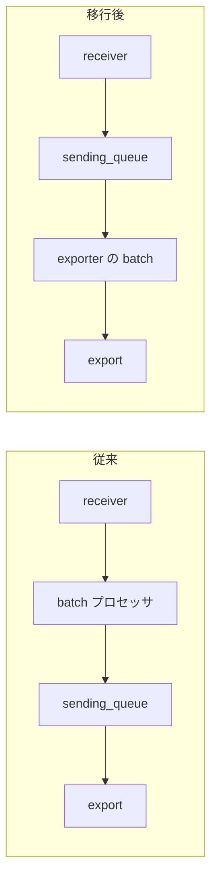

OpenTelemetry Collector の設定に `processors: [batch]` を書いている人は多いと思います。この `batch` プロセッサが、[11 月 11 日の公式ブログ](https://opentelemetry.io/blog/2026/collector-batching-migration/)で正式に非推奨になりました。置き換え先は、エクスポーターの `sending_queue` に組み込まれた batch 機能です。書き換えは数行で済みますが、キューの位置が変わるせいで、同じ `queue_size` でも入るデータ量が大きく減ります。ここを見落とすと、移行後にキューがあふれやすくなります。

## いつまでに

ブログによると、まず次のリリースから `batch` プロセッサに非推奨の警告が出ます。2027 年 2 月予定の v0.171.0 では、ほとんどのエクスポーターで exporter 側の batch がデフォルトで有効になり、2027 年 5 月予定の v0.177.0 で `batch` プロセッサが削除されます。

何もしなくても 2 月にデフォルトが切り替わりますが、`batch` プロセッサを書いたままだと 5 月に動かなくなります。ブログは、`batch` プロセッサと exporter 側の batch が両方有効なパイプラインを検出して警告を出すと書いていて、その場合は `batch` プロセッサを消すだけでよいそうです。

## 書き換え

ブログの例では、`processors` から `batch` を消し、エクスポーターの `sending_queue` の下で batch を有効にします。

```yaml
exporters:
  otlp:
    sending_queue:
      enabled: true
      batch:
        enabled: true

service:
  pipelines:
    metrics:
      receivers: [host_metrics]
      exporters: [otlp]
```

有効にしたときの `sizer`(items)、`min_size`(8192)、`flush_timeout`(200ms)は、従来の `batch` プロセッサのデフォルトと同じ値です。デフォルトのまま使っていたなら、値の読み替えは要りません。

私が取得したブログ本文のコード例は、各行が重複して崩れていました。上の YAML は「After」の内容を読み取って書き直したものなので、実際の設定は公式ページで見てください。

## キューの位置が変わる

従来は、パイプラインが `batch` プロセッサを通ってからエクスポーターの `sending_queue` に入るので、キューには batch 済みの大きなリクエストが並んでいました。新しい構成では batch がキューの後ろに移り、キューには SDK から届いた小さなリクエストがそのまま入ります。



`queue_size` のデフォルトは 1000 で、単位は `requests` です。従来は「batch 済みのリクエスト 1000 個」でしたが、移行後は「小さなリクエスト 1000 個」になります。ブログも、`batch` を外すとキューが抱えるデータが減ってあふれることがあると警告しています。

対策として、ブログは `queue_size` を増やすことと、単位を `items` か `bytes` にすることを挙げています。例はこうです。

```yaml
sending_queue:
  sizer: items
  queue_size: 100_000
  num_consumers: 10
  batch:
    enabled: true
    sizer: items
    min_size: 5_000
```

1 回の送信が最低 5,000 items で、10 個のコンシューマーが同時に送るので、送信中のデータだけで 50,000 items です。キューの上限は 100,000 items なので、その倍までは、満杯になる前に待たせておけます。

単位を `items` や `bytes` にすると、キューが使うメモリ量を見積もりやすくなります。代わりに `requests` より CPU を使い、`bytes` は符号化後のサイズを計算するので一番重くなります。移行後は `otelcol_exporter_queue_size` を `otelcol_exporter_queue_capacity` と見比べて、あふれそうになっていないか見るよう、ブログは勧めています。

## キューの挙動も選べるようになる

`sending_queue` では、`num_consumers`(同時送信数)、`block_on_overflow`(満杯時にブロックするか)、`wait_for_result`(結果を待つか)、`storage`(永続化)を設定できます。ブログによると、`batch` プロセッサの内蔵キューにはこれらがなく、そこが移行の動機でした。

ただしデフォルトは、満杯なら即失敗し、結果も待たない設定です。バックプレッシャーが欲しければ、自分で `block_on_overflow: true` などを指定することになります。

## processor のまま batch する場合

集約系のプロセッサの前で大きな batch が欲しいときや、複数のエクスポーターでプロセッサを共有してメモリを節約したいときは、新しい `queue_batch` プロセッサを使います。設定の構造は `sending_queue` と同じです。ただしブログに載っているデフォルトは `num_consumers: 1`、`queue_size: 10`、`block_on_overflow: true` で、エクスポーター側とは別物です。エクスポーターの設定をそのまま写すと、挙動が変わります。

## 試すには

ブログによれば、フィーチャーフラグ `pkg.exporterhelper.queueBatchEnabled` で、デフォルト有効化後の挙動を先に試せます。

私は Collector を実際には動かしていません。使っているエクスポーターが `sending_queue` に対応しているかは、ブログでは「ほとんどが対応」としか書かれていないので、移行前にそのエクスポーターのドキュメントを見てください。

## 出典

- [Deprecating the Collector Batch Processor(OpenTelemetry、2026-11-11)](https://opentelemetry.io/blog/2026/collector-batching-migration/)
