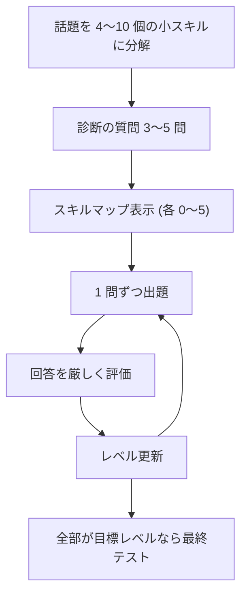

コーディングエージェントに「〇〇を教えて」と頼むと、正しくて長い解説が返ってきます。読んだ時点では分かった気になるのに、翌週に自分で書こうとすると手が止まる、ということが私にはあります。Jane Street が GitHub に置いている [Socratic Tutor](https://github.com/janestreet/agent_skills/blob/master/socratic-tutor/SKILL.md) は、その逆をやらせるスキルです。エージェントに答えさせず、1 問ずつ問わせ、習熟するまで続けさせます。SKILL.md は 102 行で、全体の流れはこうです。

レベルは小スキルごとに 0〜5 で、0 は知らない、3 は助けがあればできる、5 は人に教えられて例外も扱える、です。目標は既定で 4 です。

## 「使わない場面」が説明文に書いてある

frontmatter の description には、起動する言い回し（teach me、quiz me、drill me など）に加えて、単発の「explain X」「what is X」には使わないと書かれています。本文の冒頭にも Guard の節があり、意図があいまいなら「手短な答えがいいですか、ちゃんと教えましょうか」と一言だけ聞くことになっています。理由は、誤って始めると不要なクイズを受けさせることになるが、確認なら一言で済むから、です。

問答形式のスキルは誤発動の被害が大きく、ただ質問したかった人にいきなり診断テストが始まります。スキルを書くときは「いつ動くか」ばかり考えますが、「いつ動かないか」を description に入れる手は、問答系でなくても使えます。

## 質問は 1 つで切る

エージェントはつい、質問のあとにヒントや模範解答を足します。このスキルはそれを明示的に禁じていて、質問を出したらメッセージをそこで終えるよう指示しています。間違えたときも答えは言いません。矛盾が見える、もっと狭い質問に切り替えて、2〜3 回外してから初めて短く説明し、すぐ別の角度から同じことを確かめ直します。

## レベルの上げ方が厳しい

レベルを上げる条件は「独立した確認 2 回以上、うち 1 回は答えを教えた直後ではない想起」です。たとえば、教えた直後に同じ質問をして答えられても、それは覚えていただけなので上がりません。別の角度の問題と、後で不意に出す再テストの両方で通って、はじめて 1 つ上がります。再テストに落ちればレベルは下がります。

部分的に合っている答えは正解として扱わず、ユーザーが言っていない洞察を言ったことにもしません。「Great try!」より「惜しいですが、Y が成り立つなら X が起きるのはなぜでしょう」のほうがよい、という例まで書いてあります。正解したときにもときどき「本当に？ X の場合は？」と突っ込み、圧力の下でも答えを守れるかを見ます。迎合しがちなエージェントを締めるのに、「2 回以上の独立した証拠」のような数えられる条件を置いているのが、私には参考になりました。

## 状態は貼り付けで持ち越す

スキルは会話をまたいで状態を持てないので、「save state」と言うと、話題、各小スキルのレベル、誤解していた点のメモがひとまとまりで出力されます。新しいセッションで「resume from:」に続けて貼れば再開できます。「just tell me」と言えば、その 1 問だけ問答を解除できます。

## 日本語で使うときの注意

起動の言い回しは英語だけです。日本語で「教えて」と頼む人は、description に日本語の言い回しを足さないと起動しない可能性があります。ただし「教えて」は単発の質問にも使うので、足すなら「身につくまで」「問題を出して」のように、セッションを続けたい意図が出る言葉にしたほうが安全だと思います。目標が習熟なので対話は長くなります。Go のような広い話題を渡すと診断だけでも相当かかるので、話題は狭めたほうがよさそうです。

SKILL.md は frontmatter と普通の Markdown だけなので、Claude Code の個人用スキルとしてそのまま置けるはずです。私はまだ置いて動かしていないので、起動の挙動は試すまで分かりません。

なお Hacker News のスレッドはコメントが 1 件だけで、同じ発想の [socrates-skill](https://github.com/bevibing/socrates-skill) が先にあったという指摘でした。私はそちらを読んでいません。

## 出典

- [Socratic Tutor（SKILL.md）](https://github.com/janestreet/agent_skills/blob/master/socratic-tutor/SKILL.md)
- [Hacker News の投稿](https://news.ycombinator.com/item?id=50438261)
- [socrates-skill（HN コメントで挙げられていたもの。未読）](https://github.com/bevibing/socrates-skill)
