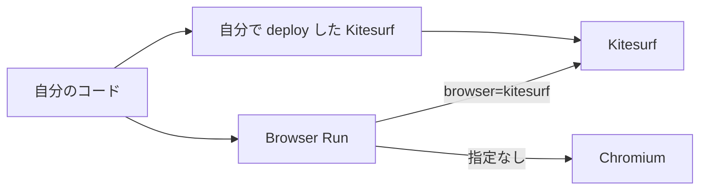

エージェントにブラウザを持たせると、セッションごとに Chromium を立ち上げることになって、メモリも CPU も思ったより食います。Cloudflare が 11 月 12 日に [オープンソース化した Kitesurf](https://developers.cloudflare.com/changelog/post/2026-11-12-kitesurf-open-source/) は、その重さを減らすために一から作られたブラウザエンジンです。changelog は短いので、ブログとドキュメントも読んで、使うならどこが分かれ目になるかを整理しました。

## Kitesurf は何か

HTML のパース、CSS の適用、ページの JavaScript 実行、スクリーンショットの描画を、Chromium もコンテナも使わず Cloudflare Workers の中だけでやります。Chrome DevTools Protocol (CDP) を話すので、Puppeteer などの既存クライアントがそのまま繋がります。ライセンスは Apache 2.0 です。

[導入ブログ](https://blog.cloudflare.com/kitesurf/)によると、中身は Rust を WebAssembly にしたものです。ページごとに独立した小さな Worker を立て、外部ネットワークに出られるのは門番役の Worker 1 つだけにしてあります。信用できないページを開く以上、取得経路を 1 か所に絞って CORS や Cookie の分離をそこで行う、という設計です。タブや拡張機能、ピクセル単位で正確な描画は捨てて、トークン数とコストを優先した、とも書かれています。

作り方にも興味を引かれました。著者らは、既存の Rust 製エンジンを AI エージェントに Workers へ移植させる試作から始めたそうです。うまくいったのは、エージェントが延々とループできるだけの計画と、成功の定義を渡してからでした。その定義に使ったのが Web Platform Tests (WPT) です。ブラウザの標準適合を測る共有テストスイートで、「ここまで通せ」を機械的に渡せます。人間は設計とレビューに回ったとのことです。

## 数字

[Browser Run のドキュメント](https://developers.cloudflare.com/browser-run/kitesurf/)に Chromium(ウォームプール)との比較があります。14 URL のコーパスで Quick Action を 5 回実行した中央値で、計測は Cloudflare 自身のものです。私は追試していません。

| 指標 | Kitesurf | Chromium | 比較 |
| --- | --- | --- | --- |
| CPU(スクリーンショット) | 380 ms | 1,173 ms | 3.1 倍少ない |
| メモリ(HTML 抽出) | 39.4 MiB | 273.7 MiB | 7.0 倍少ない |
| 壁時間(スクリーンショット) | 1,148 ms | 637 ms | 1.8 倍遅い |
| 壁時間(HTML 抽出) | 820 ms | 472 ms | 1.7 倍遅い |

課金に効く CPU とメモリは大きく減り、1 回あたりの待ち時間は伸びます。エージェントのループでは LLM の推論時間のほうが長いことが多いので、この遅さは気にならない場面も多いと私は思います。

向いていないものも、ドキュメントに書かれています。動画再生と WebGL、本物の TLS フィンガープリントが要るボット対策、状態を持ち続ける認証付きの長いセッションです。ログインして操作するエージェントには、まだ Chromium が要ります。ページを開いて本文を取る、スクリーンショットや PDF を撮る、といった使い捨ての処理が向いています。

## 使い方は 2 通り



Browser Run 経由なら、自分では何も立てません。既存の API に `browser=kitesurf` を付けるだけで、Quick Action の REST でも CDP の WebSocket でも同じです。

```sh
curl -X POST 'https://api.cloudflare.com/client/v4/accounts/<ACCOUNT_ID>/browser-run/screenshot?browser=kitesurf' \
  -H 'Authorization: Bearer <API_TOKEN>' \
  -H 'Content-Type: application/json' \
  -d '{"url": "https://example.com"}' \
  --output screenshot.png
```

Worker からは `env.BROWSER.quickAction("screenshot", { url, browser: "kitesurf" })` と書きます。MCP クライアントからは、`chrome-devtools-mcp` の `--wsEndpoint` に `?browser=kitesurf` 付きの CDP の URL を渡す形が、ドキュメントに載っています。ベータの間は無料で、アカウントごとの上限があります。

自分のアカウントにデプロイする場合が、今回オープンソースになった部分です。[README](https://github.com/cloudflare/kitesurf) によると、ビルドに Bazel(Bazelisk)、Node.js 22 以上、pnpm 9.15.4 が要ります。ローカルでは `pnpm run dev` で `wrangler dev` が立ちますが、Cloudflare 上で動かすには Dynamic Workers が必要で、Workers Paid プランが必須です。認証機能は組み込まれていないので、Cloudflare Access などで自分で守ります。README には、Access のサービストークンを `CF-Access-Client-Id` と `CF-Access-Client-Secret` ヘッダで渡す Puppeteer の例があります。

つまり、手元のマシンに置いて動かすためのものではありません。ローカルで動くのは開発用だけです。

## 実験段階です

changelog は、Kitesurf は experimental で開発が活発だと明記しています。WPT の通過数も動きが速く、[更新ブログ](https://blog.cloudflare.com/kitesurf-update/)は 73 万 subtests 以上、公開時より 50 万増えたと書いています。一方、Browser Run のドキュメントの標準適合の節は「23 万 5 千 subtests 以上」のままです。ドキュメントの更新が追いついていないのだと思われます。

更新ブログには WebMCP への対応も入っています。サイト側が `searchFlights()` のような関数をエージェントに直接公開する仕組みで、クリックを真似るより安定する、という位置づけです。

## どう試すか

まず [kitesurf.dev のプレイグラウンド](https://kitesurf.dev/)に、自分のエージェントが実際に見に行くサイトの URL を入れてみるのが早いです。ドキュメントも、互換性は試すのが一番だと書いています。崩れるサイトだけ Chromium に回すなら、`browser=kitesurf` を付けるかどうかで切り替えられます。

## 出典

- [Kitesurf is now open source (Cloudflare changelog, 2026-11-12)](https://developers.cloudflare.com/changelog/post/2026-11-12-kitesurf-open-source/)
- [Introducing Kitesurf (Cloudflare Blog)](https://blog.cloudflare.com/kitesurf/)
- [The road to the agentic browser: A Kitesurf update (Cloudflare Blog)](https://blog.cloudflare.com/kitesurf-update/)
- [Kitesurf (Browser Run docs)](https://developers.cloudflare.com/browser-run/kitesurf/)
- [cloudflare/kitesurf (GitHub)](https://github.com/cloudflare/kitesurf)
