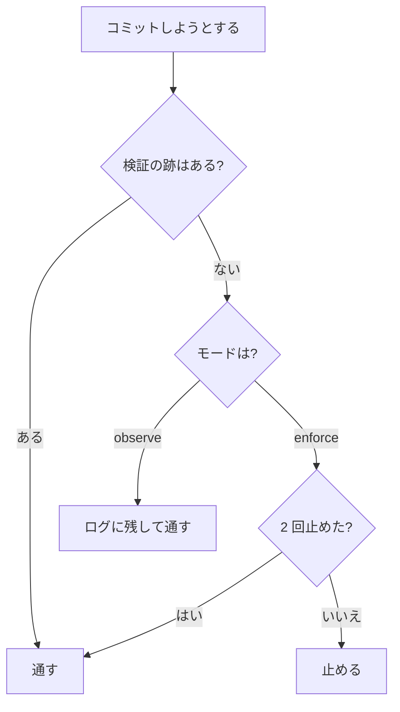

コーディングエージェントが作ったコミットのうち、実際に動かして確かめたものがどれなのかを、あとから git で一覧できるだろうか。そう思って試しました。きっかけは、Claude Code チームが書いた [検証の考え方についての記事](https://claude.dev/blog/how-the-claude-code-team-thinks-about-verification/) です。著者の Addy Osmani さんは、チームのリポジトリでは各コミットに「どう検証したか」の印を付けていて、値には「none」もある、と書いています。検証していないコミットを検索できるようにするためです。

記事は印の実装方法を書いていないので、git のコミットメッセージの trailer で同じことを再現してみました。

## trailer で印を付けて引く

```sh
git commit -m "first" --trailer "Verified: e2e"
git commit -m "second" --trailer "Verified: none"
git commit -m "third"
```

印はこう一覧できます。

```sh
git log --format='%h %s%n%(trailers:key=Verified,valueonly)' | grep .
```

```
c18b1b0 third
216977f second
none
8befeb5 first
e2e
```

third には印がないので、下の行がありません。`valueonly` の出力は値のあとに改行が付くため、1 行にまとめるのは面倒でした。上のように次の行に出して、空行を `grep .` で落とすのが楽でした（git 2.47.3 で確認）。

「none と書いたもの」と「そもそも印がないもの」は別々に引けます。

```sh
git log --format='%h %s' --grep='^Verified: none'
```

```
216977f second
```

```sh
git log --format='%h %s' --grep='^Verified:' --invert-grep
```

```
c18b1b0 third
```

印のないコミットを未検証とみなすか、運用前の古い履歴とみなすかは運用で決めることになります。none を書かせる意味は、「確かめなかった」と「記録し忘れた」を分けられる点にあると思います。

## 印を見て止めるゲートは、observe から始める

記事では、セッション内で `/code-review` か `/verify` が走っていないコミットを止めるゲートも使っています。モードは off、observe、enforce の 3 つです。observe は止めるはずだったコミットをログに残すだけで、誤検知を確認してから enforce に上げます。enforce でも、同じセッションで 2 回止められたら 3 回目は通します。Claude Code も完璧ではないので、詰まらせないためだそうです。検証しなかった理由をコミットメッセージに書けば通すこともできます。



ゲートの誤検知で作業が止まると、ゲートごと外したくなります。最初に observe で様子を見るのは、それを避ける順番だと思います。

## 検証する側は、変更が書き換えられない場所に置く

エージェントが PR を作る運用で、もっと気になったのがこの点です。記事は「変更が自分を判定するチェックを書き換えられるなら、そのチェックは壊れている」と書いています。Code Review は REVIEW.md を、PR の変更ではなくベースブランチかデフォルトブランチから読みます（[公式ドキュメント](https://code.claude.com/docs/en/code-review-customize)）。lint が落ちたときに、エージェントがコードではなく lint のほうを緩められる状態では、通ったという結果に意味がありません。

記事のほかの話も、この延長にあります。不安定なテストはスキップや sleep やリトライで通すことを禁じ、原因が見つからなければテストを消して理由を書く。3 回直しても通らなければ Claude が止まって人を呼ぶ。つまり、人が読むのは差分全部ではなく、検証が通らなかったものだけになります。

なお記事の冒頭にある「コードの約 90% を Claude が書き、レビューもしている」はチーム自身の数字で、外から確かめる手段は見つけられていません。

## 出典

- [How the Claude Code team thinks about verification](https://claude.dev/blog/how-the-claude-code-team-thinks-about-verification/)
- [Hacker News の議論](https://news.ycombinator.com/item?id=50529612)
- [Code Review のカスタマイズ（REVIEW.md）](https://code.claude.com/docs/en/code-review-customize)
