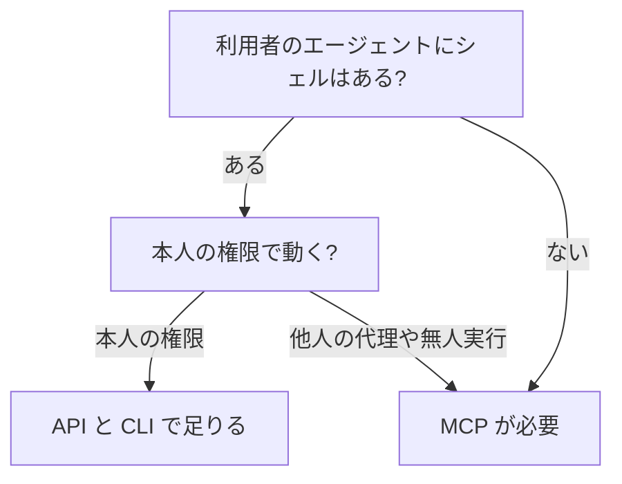

自社の API が公開済みなら、エージェントにはそれを叩かせれば済むのでは、と思うことがあります。MCP をめぐるこの 9 か月ほどの議論を読み直したところ、答えは API があるかどうかではなく、使う側のエージェントにシェルがあって本人の権限で動くかどうかで分かれる、というのが私の理解です。出すと決めた場合は、ツールを絞り、返り値を項目指定にしておけば、コンテキストの重さはかなり抑えられます。

## 「MCP は死んだ」の中身

発端の一つは、Eric Holmes さんの [MCP is dead. Long live the CLI](https://ejholmes.github.io/2026/02/28/mcp-is-dead-long-live-the-cli.html)（2026 年 2 月末）です。LLM は man ページやシェルスクリプトで学習済みなので CLI をそのまま使える、人間も同じコマンドで再現できる、`jq` や `grep` とつながる、認証は `gh auth login` や `aws sso login` が既にある、と書いています。権限も、`gh pr view` は許可して `gh pr merge` は確認を挟む、というコマンド単位の制御ができる、という主張です。

ただ Holmes さんは [Hacker News のコメント](https://news.ycombinator.com/item?id=47208398)で、記事は意図的に挑発的に書いた、本心はもっと穏当だと言っています。不満の矛先は、公式 CLI を出さず MCP だけを出した Datadog と Slack でした。

その後、[Stacklok](https://stacklok.com/blog/mcp-vs-cli-tools-why-security-changes-the-answer) と [Milvus のブログ](https://milvus.io/ja/blog/is-mcp-dead-cli-and-skills-for-ai-agents.md)が、Perplexity の CTO が社内で MCP の優先度を下げると発言し、Garry Tan さんが CLI の代替を 30 分で作った、と紹介しています。この 2 件の一次情報は私は確認していません。なお Stacklok は MCP ゲートウェイを売る会社、Milvus は自社の CLI と Skills を勧める立場で書いています。

## 使う人が違えば結論も違う

Holmes さんが想定しているのは、自分のマシンで、自分のアカウントで、エージェントを動かす開発者です。この場合は API と CLI で足りる、という主張はそのとおりだと思います。

反対側の例として、[jngiam さん](https://jngiam.bearblog.dev/mcps-clis-and-skills-when-to-use-what)は、個人用の環境では Skills・CLI・API 直叩きが中心で MCP は 4 つ、仕事用では MCP が 10 以上で CLI はほとんど無い、と書いています。仕事用では cron で無人で動くエージェントが 10 個以上あり、それぞれに必要なツールだけを渡した MCP を持たせています。通話記録は読めるがメールは送れない、という線引きをサーバー側の設定で一度決められるからです。CLI で同じことをやると、CLI ごとにラッパーが要ると言います。

Stacklok は、CLI だと認証情報がエージェントの実行環境に載り、MCP だと認証情報は MCP サーバー側に置ける、という違いを挙げています。Hacker News には、Sentry は URL を 1 つ配るだけで、クライアント側がログイン画面を出してくれる、という書き込みもありました。ChatGPT や Claude.ai のようにシェルのない利用者は、そもそも CLI を選べません。

## 出すなら気をつけること

出す価値は、上の分岐の右側、つまりシェルのない利用者に届くことと、ツール単位で権限を絞れることにあります。

重くなる点は、[OpenRouter の計測](https://openrouter.ai/blog/insights/mcp-vs-cli-vs-skills)が具体的です。GitHub の MCP サーバーは既定で 46 個のツールを持ち、定義だけで毎リクエスト 19,436 トークン（Claude の場合）を足します。「cli/cli の最新リリースと、bug ラベルの新しい issue 3 件を答える」という 1 つのタスクを Sonnet 5.5 に解かせたときの入力トークン合計は、`gh` CLI が 1,421、MCP（46 ツール）が 59,417 でした。全 91 ツールを有効にすると 101,351 です。1 つのサーバーと 1 つのタスクの結果で、OpenRouter は自社の Tool Search も宣伝する立場なので、数字は目安として見ています。

定義より重かったのが返り値で、最新リリースを取るツールが返したオブジェクトだけで約 20,400 トークンありました。必要なのはタグと日付だけで、CLI なら `gh release view --json tagName,publishedAt` の一行です。

直し方も同じ記事に載っています。

- ツールをタスクに要る 2 つだけに絞ると 23,228 トークン
- さらに返り値を 4,000 文字で切ると 5,357 トークン。ただし、欲しい項目がたまたま先頭にあったから効いただけだと、著者が注意しています
- `list_issues` に `fields` 引数があり、モデルが項目を指定すると、結果が 8,336 文字から 714 文字になった

API をそのまま 1 対 1 でツールにして返り値も丸ごと返すと、上の一番重い行になります。出すなら、ツールは数個に絞り、返り値は項目を選べるようにする、が現実的な線だと思います。OpenRouter は、定義が約 1 万トークン、または約 10 個を超えたら、必要なときだけ読み込む Tool Search を考えるよう勧めています。

仕様の側は、[2026-07-28 版](https://modelcontextprotocol.io/specification/2026-07-28/changelog)でセッションと `initialize` の握手がなくなり、リクエストごとにバージョンと機能を載せる形になりました。サーバーをステートレスな HTTP ハンドラとして書きやすくなる方向ですが、実装して確かめてはいません。Roots・Sampling・Logging や動的クライアント登録は非推奨になりましたが、廃止まで最低 12 か月の猶予があるので、今すぐの作り直しは要らなさそうです。

## 出典

- [MCP is dead. Long live the CLI（Eric Holmes）](https://ejholmes.github.io/2026/02/28/mcp-is-dead-long-live-the-cli.html)
- [When does MCP make sense vs CLI?（Hacker News）](https://news.ycombinator.com/item?id=47208398)
- [MCPs, CLIs, and skills: when to use what?（jngiam）](https://jngiam.bearblog.dev/mcps-clis-and-skills-when-to-use-what)
- [MCP vs CLI Tools: Why Security Changes the Answer（Stacklok）](https://stacklok.com/blog/mcp-vs-cli-tools-why-security-changes-the-answer)
- [Is MCP Dead? MCP vs CLI vs Agent Skills Compared（Milvus）](https://milvus.io/ja/blog/is-mcp-dead-cli-and-skills-for-ai-agents.md)
- [MCP vs CLI vs Skills: What Each Costs in Context（OpenRouter）](https://openrouter.ai/blog/insights/mcp-vs-cli-vs-skills)
- [MCP 仕様 2026-07-28 の変更点](https://modelcontextprotocol.io/specification/2026-07-28/changelog)
