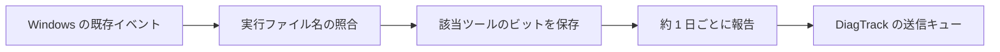

Windows 11 の内部に、`claude.exe` や `codex.exe` といった実行ファイル名を照合して、使ったかどうかを診断データとして送る仕組みがある、という調査が出ました。調べたのは Xusheng Li さんで、[ブログの記事](https://xusheng.dev/posts/windows-coding-agent-telemetry/)にまとまっています。

きっかけは、最新の Windows のバイナリから未公開の機能を探すのを AI に手伝わせたことだそうです。出てきた手がかりの一つが、`MissionControlAggregator.dll` に埋まっていた実行ファイル名の一覧でした。

## 何を見ているのか

照合している名前は、著者によると次のとおりです。

- CLI 型のエージェント: `copilot.exe`、`claude.exe`、`codex.exe`、`agy.exe`(WSL 側は拡張子なし)
- デスクトップ型のエージェント: `github.exe`、`claude.exe`、`codex.exe`、`cursor.exe`、`antigravity.exe`
- 開発ツール(12 カテゴリ): `node.exe`、`python.exe`、`dotnet.exe`、`gcc.exe`、`clang.exe`、`gdb.exe`、`javac.exe`、`devenv.exe`、`code.exe` など

この機能には `CLICodingAgentUsage` という名前が付いています。

名前の取り方は、プロセスを自分で走査するのではなく、Windows がすでに出しているイベント(`KernelProcess.AppStateChangeSummary` など)の中のアプリ名を照合するものです。WSL では `Microsoft.Windows.Lxss.Manager.Exec` の `imageName` を使います。Windows ネイティブの `codex.exe` でも引っかかるので、WSL の中だけの話ではありません。

## 送られるのは「使ったか」だけ

元のイベントには実行時間やフォーカス時間、操作回数も入っています。ところがこのコンポーネントはそれらを捨てて、報告期間中にそのツールを見たかどうかを、ツールごとに 1 ビットで持つだけだ、と著者は書いています。

たとえば CLI 型エージェントは 4 つの位置に割り当てられていて、Codex は 3 番目(位置 2)です。Codex を見ると `1 << 2`、つまり `4` が立ちます。報告の名前は `Segments.SubCohorts` で、この数値の配列が入ります。gcc や clang のようなコンパイラ・デバッガ類は 1 つの位置を共有していて、見つかると `8`(`1 << 3`)になります。個別のツール名は報告に載りません。プロンプトやソースコードも見つからなかった、と著者は書いています。

## 名前だけで判定される

著者は `cmd.exe` を `codex.exe` という名前でコピーして動かし、それだけで Codex の位置にビットが立つことを確かめています。`gcc.exe` という名前のコピーでも同じで、送信キューに `SubCohorts: [8]` が入ったそうです。Node.js、Python、.NET、Visual Studio は発行元も確認しますが、GCC や Clang のグループは名前だけです。

名前を合わせただけの別物も数に入るので、私は、個人を厳密に追うためというより、利用者全体の割合を見るための仕組みだろうと思います。ただ、Microsoft が何に使うのかは記事に書かれていません。

## 送られる条件と、止め方

この報告は「オプションの診断データ」に分類されます。著者が米国設定でクリーンインストールした Windows 11 Home(ARM64)では、初期状態で診断データが「オプションを含める」になっていて、`AllowTelemetry` は `3` でした。この状態で、DiagTrack の送信キューに報告が入っているのを確認したそうです。

止めるには、設定の「プライバシーとセキュリティ」→「診断とフィードバック」で、オプションの診断データの送信を切ります。インストール時に断ることもできます。切った状態で報告が本当に止まることまでは、記事では試されていません。

## どこまで確かめられているか

著者は、公開 ISO から入れた直後の仮想マシンでは、この機能がイメージの既定で無効だったと書いています。動いていたのは、サービス実験として有効になっていた手元の仮想マシンです。全員の Windows で動いているとは言えません。

確かめられた既定値は、米国設定の Home 版 1 台だけです。他の地域や Pro / Enterprise でどうなるかは、記事からは分かりません。私は自分では再現していません。手元に Windows がないので、ここまでは著者の調査をそのまま紹介しています。

[Hacker News のスレッド](https://news.ycombinator.com/item?id=50524736)は、読んだ時点でコメントが 2 件だけで、内容のある議論はまだありませんでした。

Windows でエージェントを使っているなら、設定画面でオプションの診断データが入っているかを見てみてください。

## 出典

- [Windows 11 Is Collecting Data on Which Coding Agents and Developer Tools You Use(Xusheng Li)](https://xusheng.dev/posts/windows-coding-agent-telemetry/)
- [Hacker News のスレッド](https://news.ycombinator.com/item?id=50524736)
