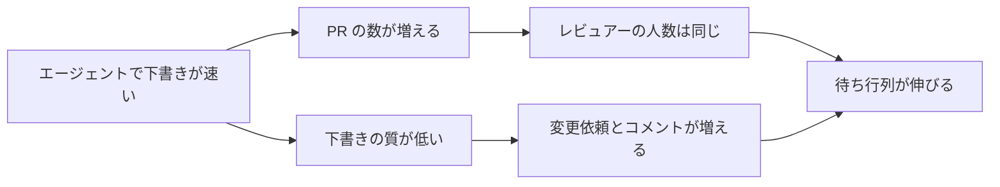

Hacker News で、コーディングエージェントを導入した会社ではレビューが詰まる、という Harvard の論文を紹介した記事が話題になっています。コメント欄は「半年前から知っている」と「うちは逆だ」に割れていました。論文の中身と一緒に、その割れ方をまとめます。

先に書いておくと、私が読んだのは論文ではなく、それを詳しく解説した [ComplexDiscovery の記事](https://complexdiscovery.com/harvard-researchers-find-ai-coding-agents-shifted-the-bottleneck-to-code-review/)です。論文の PDF（[Artificial Intelligence in the Firm: Bottlenecks in Software Production](https://fion.ac/jellyfish.pdf)）は開いていません。以下の数字は、解説記事が論文から引いたものです。

## 何を測った論文か

著者は Harvard の博士課程の Fiona Chen と James Stratton。開発チームの活動を分析するサービスを売っている Jellyfish のデータで、718 社・約 73 万人を 2021 年 1 月から 2026 年 3 月まで追っています。エージェントの導入時期が会社ごとにずれていることを使い、導入した会社としていない会社を月ごとに比べる設計です。導入時期がずれた理由は主に調達や法務・セキュリティの承認にかかった時間で、会社の成長の速さとは関係が薄い、というのが著者の主張です。

結果は次のとおりです（いずれもエージェント導入の追加効果）。

- 1 人あたりの追加行数は月 1,494 行増えた。基準の 5,017 行に対して約 30%。コミットは 20%、PR は 23% 増えた
- 完了した Jira issue（本番にデプロイされたもの）は月 0.12 件増。基準は 3.67 件で、標準誤差 0.17 なので、ゼロと区別できない
- PR を出してからマージされるまでは、基準の 7.03 日に 3.45 日が上乗せされて約 10.5 日になった。49% の増加
- 変更依頼がつく PR は 13% から約 25% に、ほぼ倍になった。PR あたりのレビューコメントは 35% 増えた

issue が大きくなっただけで件数が増えなかった、という可能性は、著者が GPT-4o で issue の大きさをラベル付けして調べています。平均サイズは変わらず、PR も大きくなっていなかったそうです。

## 二つの詰まり方

著者は、レビューが詰まる理由を二つに分けて説明しています。

上の経路は、レビューに人や時間を回せば解消できます。下の経路は、変更依頼とコメントが増えた事実から著者が「質が低いサインだろう」と読んだもので、解消にはエージェント側の改善が要る、と著者は書いています。前者なら人の配分、後者ならエージェントへの指示やテストに手を入れる話になります。

AI レビューツールがあっても詰まりが残っていることも書かれています。2026 年 3 月までに約 8 割の会社が何らかの AI レビューを使っていましたが、レビューコメントのうち AI によるものは 23.3%、AI のコメントが一件でもついた PR は 10.8% でした。

インタビューには、AI 生成コードが原因の障害のあと「AI が書いたコードは上級エンジニアの承認が必須」というルールができ、レビューの列がさらに長くなった、という証言があります。対策のつもりのルールが、詰まりを増やした例です。

## 割り引いて読むところ

解説記事は、データ提供元の Jellyfish が研究の利害関係者であることを指摘しています。著者は Jellyfish のブログにも寄稿していて、Jellyfish は原稿を機密情報の確認のためだけに見たとされています。Jellyfish は今年 1 月の初期版を引いて「コード品質は落ちていないようだ」と発信していましたが、8 月版は変更依頼の倍増を品質低下の可能性として読んでいて、見え方が変わっています。査読が終わった記載はなく、データは 2026 年 3 月で切れています。

NBER の別の論文（[Writing Code vs. Shipping Code](https://www.nber.org/papers/w35275)）も、自律エージェントによるコミットが累計 240% 増えた一方、実際のリリースは 30% しか増えなかったと報告している、と解説記事にあります。方向は同じですが、こちらも未読で、著者二人は Microsoft の研究コンサルタントを務めているという注記がついています。

## HN の反応

[議論](https://news.ycombinator.com/item?id=50538303)のうち、私が読んだのは先頭付近のコメントです。

「古い」という声がありました。最新のモデルは人間より質の高いコードを書き、レビューは設計と統合の確認に変わった、これから詰まるのは仕様と優先順位づけとテストだ、という意見です。この人は CI のチェックを増やして LLM をガードレールの中に置く仕事に寄ってきたそうです。

一方で、レビューをやめればいいという案には反発がありました。ある会社では、エージェントに PR まで出させて自分で承認すれば第二の目を迂回できると気づいた人が出て、誰もレビューしていない状態になりつつあるといいます。別のコメントは、SOC 2 の監査対象なら、レビューしていると言いながらしないのは不正になると指摘していました。

「そもそも問題は仕様だ」という声には、「間違った問題を解く PR を延々とレビューさせられているだけ」「最初の仕様が最後まで残ったプロジェクトを見たことがない」という反論がついていました。エージェントは仕様を絶対視して現実との摩擦を回避する、人間なら立ち止まる場面だ、という長いコメントもありました。

論文のインタビューは「上級エンジニアが週一でしか見られない」という組織の問題で、AI のせいではないという批判もありました。ただ、そのレビュー待ちは、エージェントで PR が増える前から構造としてあったものでしょう。私は、エージェントがそれを表に出して悪化させたと読めば論文の主張と矛盾しない、と考えています。

## 自分のリポジトリで見るなら

「レビューが詰まっている」という感覚を、二つの数字に分けて見られます。

- マージまでの時間と、レビュー待ちの PR 数（量）
- 変更依頼がついた PR の割合と、PR あたりのコメント数（質）

エージェントを入れたあとに前者だけが伸びているなら、レビュアーの時間配分で済む話です。後者も伸びているなら、指示書やテストのほうを疑うことになります。

## 出典

- [Harvard researchers find AI coding agents shifted the bottleneck to code review（ComplexDiscovery）](https://complexdiscovery.com/harvard-researchers-find-ai-coding-agents-shifted-the-bottleneck-to-code-review/)
- [Hacker News の議論](https://news.ycombinator.com/item?id=50538303)
- [Artificial Intelligence in the Firm: Bottlenecks in Software Production（論文。未読）](https://fion.ac/jellyfish.pdf)
- [Writing Code vs. Shipping Code（NBER。未読）](https://www.nber.org/papers/w35275)
