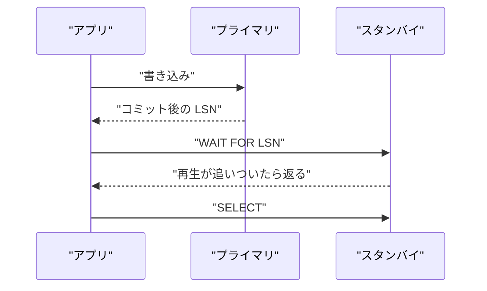

PostgreSQL 19 が昨日（2026-11-19）リリースされました。[公式のリリース告知](https://www.postgresql.org/about/news/postgresql-19-released-3449/)は項目が多いので、Go でバックエンドを書いている人の目で、アプリのコードやデプロイに触るものだけを拾います。私が読んだのはこの告知だけで、詳細なリリースノートは読んでいません。構文の細部や挙動の条件は、使う前にリリースノートで確認してください。

## get or create が 1 文で書ける

`INSERT ... ON CONFLICT DO SELECT` が入りました。告知によると、衝突した既存の行を `RETURNING` で返せます。

これまでの「なければ作る、あれば取る」は、だいたい次のどちらかでした。

- `ON CONFLICT DO NOTHING` で挿入し、0 行だったら `SELECT` し直す（往復が 2 回）
- `ON CONFLICT DO UPDATE SET x = EXCLUDED.x` と、意味のない更新で行を返させる

告知は、前者の往復が 1 回に減ると書いています。後者の無駄な更新も要らなくなる、と私は読みました。sqlc や pgx でこの形を書いている箇所があれば、置き換え候補になります。

## レプリカから読んでも、自分の書いた内容が見える

読み取りをスタンバイに流している構成だと、書いた直後に読んで古い値が返ることがあります。`WAIT FOR LSN` は、スタンバイが指定した LSN まで WAL を再生し終えるのを待ってからクエリを実行できるコマンドです。

これまでは LSN を自前で比べてポーリングするか、重要な読み取りだけプライマリに回していました。後者の範囲を狭められるかもしれません。タイムアウトの扱いなどは告知に書かれていないので、使う前に調べる必要があります。

## 止めずにテーブルを整理する REPACK

`VACUUM FULL` と `CLUSTER` は、終わるまでテーブルへのアクセスを止めます。新しい `REPACK` は同じ役目で、`REPACK (CONCURRENTLY)` なら読み書きを止めずに実行できます。旧コマンドも互換のために残ります。肥大化がわかっていても止められなくて放置していたテーブルがあるなら、試す価値があります。実行中のディスクや負荷の増え方は、告知には出ていません。

## アップグレードで挙動が変わる既定値

アプリのコードは変えなくても、アップグレードの結果が変わる点があります。影響の大きそうな順に並べます。

RADIUS 認証が削除されました。使っているなら、アップグレード後に接続できなくなります。

JIT がデフォルトで無効になりました。告知は、JIT を使うかどうかの判断に使うコスト見積もりが当てにならなかったためと説明しています。大きな集計クエリを流す環境では、有効にし直すかどうかの判断が要ります。

`io_workers` が `io_min_workers` と `io_max_workers` に置き換わりました。設定ファイルに `io_workers` を書いていると、移行で引っかかるはずです。

`md5` パスワード認証に成功すると警告が出るようになりました（`md5_password_warnings` で止められます）。md5 は 18 で非推奨になっていて、将来削除されます。動かなくなるわけではないので急ぎではありませんが、SCRAM への移行は今のうちに済ませておけます。

## ほかに気になったもの

`pg_plan_advice` と `pg_stash_advice` は、クエリ識別子ごとにプランへの助言を保存して自動適用する拡張です。遅くなったプランを、アプリを触らずに直せます。PostgreSQL はヒント句を入れない方針で来たので、私にはこれが大きな方向転換に見えます。

外部キーの検査も速くなり、告知は「テストでバルクインサートがほぼ 2 倍になった」と書いています。測ったスキーマは書かれていないので、自分のテーブルでの数字は別に測る必要があります。

## 出典

- [PostgreSQL 19 Released!（PostgreSQL、2026-11-19）](https://www.postgresql.org/about/news/postgresql-19-released-3449/)
