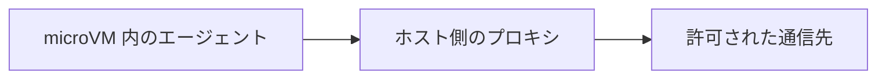

Docker が新ブランドを発表したというので、公式ブログの「[Meet the New Docker: Built to Run on Trust](https://www.docker.com/blog/meet-the-new-docker-built-to-run-on-trust/)」を読みました。ロゴとクジラ（Moby）のリニューアルに、「これからの Docker はエージェントを信頼して動かすための会社になる」という方針表明が付いた内容で、新しい技術情報はほとんどありません。ただ、その方針を支える製品が Docker Sandboxes で、こちらは普段コーディングエージェントを使っているなら気になる設計でした。

## 発表本文が言っていること

筆者（Docker の CMO）は、コンテナはワークロードを隔離するもので、エージェントは何を実行し、何にアクセスし、何を変えるかを自分で決める「アクター」だと書いています。だから隔離と統制を別に用意する必要がある、という主張です。コンテナも、開発者ファーストの姿勢も変えないとしています。

具体的な製品名は最後の段落に出るだけです。試してほしいものとして Docker Sandboxes と Docker AI Governance が挙がり、動画の説明文には Docker Hardened Images も出てきます。機能の説明や料金は本文にありません。

## Sandboxes の設計

四月に出た [Why MicroVMs: The Architecture Behind Docker Sandboxes](https://www.docker.com/blog/why-microvms-the-architecture-behind-docker-sandboxes) に、中身が書かれています。エージェントの 1 セッションごとに 1 つの microVM を割り当て、その中に専用の Docker デーモンを置く構成です。コンテナでは、エージェントが `docker build` などを使うために Docker-in-Docker の特権が要り、せっかくの隔離が弱まります。microVM ならカーネルごと分かれるので、エージェントはホストのソケットをマウントせずに `docker build` や `docker compose` を使えます、というのが Docker の説明です。

同じ記事に、こういう一文があります。

> An LLM deciding its own security boundaries is not a security model. The bounding box has to come from infrastructure, not from a system prompt.

ファイル、ネットワーク、シークレットの範囲は、エージェントが動く前に決めます。ブランド記事の「エージェントはアクターだ」は、設計ではここに当たると私は読みました。

構成は [Andrew Lock さんの解説](https://andrewlock.net/running-ai-agents-safely-in-a-microvm-using-docker-sandbox)が引いている公式のセキュリティ文書によると、次のとおりです。

外への通信は必ずホスト側のプロキシを通り、許可のない宛先はそこで止まります。認証ヘッダもプロキシが付けるので、エージェントは API キーそのものを持ちません。作業ディレクトリだけが、ホストと共有されます。

## 使った人の感想

Lock さんは、Claude Code を `--dangerously-skip-permissions` で動かすためにこれを使っています。権限確認で止まるのが生産性の敵で、sandbox の中なら被害が作業ディレクトリに収まるので、確認なしで走らせても気が楽だそうです。

不満も具体的です。ネットワークポリシーの Balanced ではドキュメントサイトなどが通らず、結局 open にしています。1Password によるコミット署名が sandbox 内で使えず、ホスト側で rebase して署名し直しています。小さなプロジェクトでも、性能低下が重くて使えない場面があったそうです。Docker は「トレードオフはない」と書いていて、Lock さんの経験とは食い違います。私は動かして確かめていません。

Lock さんが open にしても気にしていない理由が、私には一番印象に残りました。sandbox にはキーも私的なデータも入っていないから、どのサイトに行かれても困らない、という理屈です。通信先を絞る手間をかけるより、守りたいものを最初から中に入れないほうが効くのだと思います。

Linux での利用は、Lock さんの記事では macOS (arm64) と Windows のみ対応とされ、Docker の記事は Linux の KVM にも対応すると書いています。Linux で試すなら、先に最新のドキュメントを見たほうがいいです。Docker AI Governance は、本文にも動画の説明にも中身がなく、読んでいません。

## 出典

- [Meet the New Docker: Built to Run on Trust](https://www.docker.com/blog/meet-the-new-docker-built-to-run-on-trust/)（Docker 公式ブログ）
- [Why MicroVMs: The Architecture Behind Docker Sandboxes](https://www.docker.com/blog/why-microvms-the-architecture-behind-docker-sandboxes)（Docker 公式ブログ）
- [Running AI agents safely in a microVM using docker sandbox](https://andrewlock.net/running-ai-agents-safely-in-a-microvm-using-docker-sandbox)（Andrew Lock）
