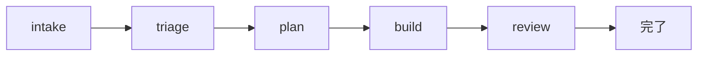

TypeScript のエージェントフレームワーク Mastra が、自分たちの開発に使っているツールを [Mastra Factory](https://news.ycombinator.com/item?id=50548660) として OSS で出しました。Show HN の投稿、公式ブログ、テンプレートの README を読んだので、中身と、議論で一番気になった点を書きます。

## 何をするものか

投稿の著者は、Factory を「Slack から @ で呼べる、設定可能なエージェント版かんばんボード」と説明しています。GitHub、Linear、Slack とつながり、issue を選んで開始を押すと、コーディングエージェントがサンドボックスの中で作業します。[公式ブログ](https://mastra.ai/blog/announcing-mastra-factory)によると、工程は次のとおりで、各工程に関門（次へ進む前の確認の段階）が置かれています。

部品は Mastra 自身のものです。長時間動く durable agent、会話の記憶、出典付きの Markdown wiki、PR コメントを購読して作業に戻す signals、クラウドのサンドボックスが挙がっています。

ブログはソフトウェアファクトリーを 4 つの型に分けています。

- 目標駆動: 監督役のエージェント 1 つとサブエージェントに、`/goal` を渡す
- 段階的な自動化: 開発の各段階に関門を置き、変更を測定でき、戻せるようにする
- 学習する基盤: 組織の記憶と本番での結果を、次の実行に生かす
- 人間の仕事の再設計: 人の進め方をエージェントとの協働に合わせて作り直す

Mastra は 2 つ目と 3 つ目寄りだと書いています。

試すには `npm create factory` を使います。生成される[テンプレート](https://github.com/mastra-ai/softwarefactory-template)の README で目に留まったのは次の 3 点です。

- サーバーは PostgreSQL（pgvector 付き）を使う
- Factory のサーバーは、エージェントに直させたいリポジトリとは別に置く前提
- サンドボックスを `local` にすると、サーバーの OS ユーザーの権限で、隔離なしにコマンドが走る。本番ではプラットフォームか E2B の認証情報が無いと起動しないので、`local` は明示的に選ぶ回避策になっている

## 外部からの PR を受けなくなった

投稿によると、Mastra の Factory は先週 238 件の PR を開いてマージし、人間は 630 件をマージしました。単純に足すと、Factory は全体の約 27% です。Mastra 側の [X の投稿](https://x.com/smthomas3/status/2097592681421512880)にある「PR の 30% を書き、issue の 60% を閉じた」とも大きくは合います。「Factory が開いた PR」に、人が指示して作らせた分が含まれるのかは、読んだ範囲ではわかりませんでした。

ただ、私が一番気になったのは数字ではなく、リポジトリを外部のコントリビューターに閉じたという話です。投稿の著者は、代わりに再現手順の詳しい issue を求めていると書いています。HN で「これは今後の標準になるのか」と聞かれて、著者は、sindresorhus なども同じ理由で閉じていて、価値の薄い PR が激増し、しかも自分で直すほうが速くなったからだと答えています。

別の返信は、issue にも新しい種類のゴミが出ていると書いています。Opus は、どのスプリントでも優先しないような issue を作りたがる。間違ってはいないが、なぜ気にする必要があるのかがわからない。次の課題は「本当に重要な issue だけを直す」ことだ、という内容です。

公式ブログも、Factory 導入前の詰まりは issue の受付と PR のレビューにあったと書いています。実装をエージェントに任せられるようになると、人間側に残る作業は「何をやるか決める」と「レビュー」になるのだと思います。私は、エージェントに作業させる前に、その issue を人が一度は優先付けしたかを決めておくのがよいと考えています。図で triage が実装より前にあるのは、その位置だと読みました。triage が何を基準に重要と判定するのかは、読めていません。

Claude Code や Codex への対応は「作業中」と投稿にあり、今は Mastra 自前のコーディングハーネスが前提です。

## 出典

- [Show HN: Mastra Factory, the open-source software factory we use to build Mastra](https://news.ycombinator.com/item?id=50548660)（投稿とコメント）
- [Announcing Mastra Factory](https://mastra.ai/blog/announcing-mastra-factory)（Mastra 公式ブログ）
- [mastra-ai/softwarefactory-template](https://github.com/mastra-ai/softwarefactory-template)（README）
- [Mastra 側の X 投稿を引用しているページ](https://x.com/smthomas3/status/2097592681421512880)
