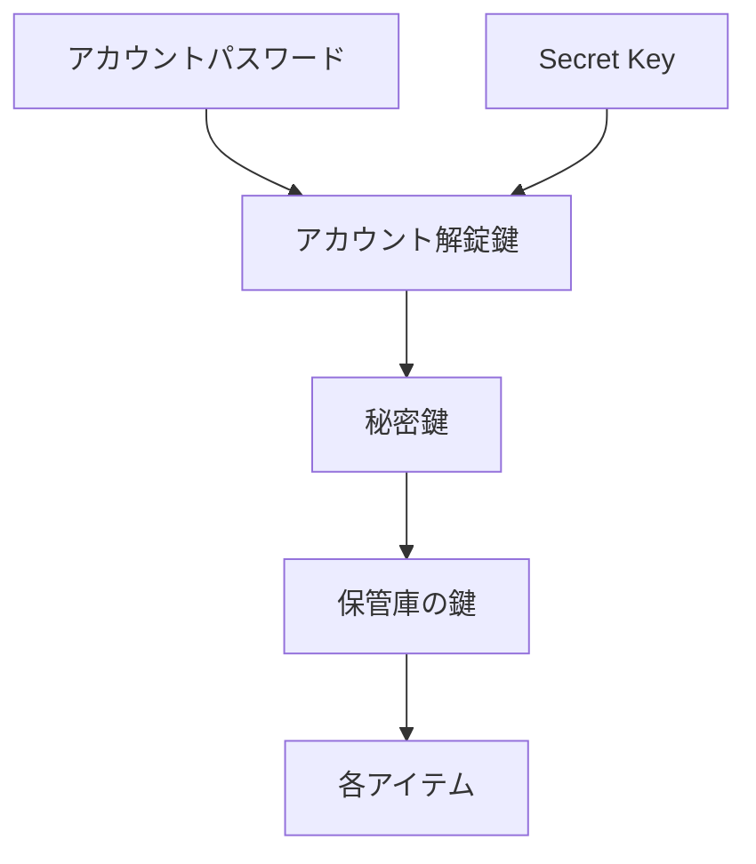

1Password の仕組みを知りたいとのことだったので、公式の[セキュリティ設計白書](https://1passwordstatic.com/files/security/1password-white-paper.pdf)を読みました。最初に確かめたかったのは、サーバーのデータが丸ごと盗まれたら何が起きるか、です。結論は、サーバーだけが破られた場合は総当たりが成り立たず、端末が破られた場合はそうならない、でした。

## 鍵は三段になっている

白書によると、暗号化はすべて手元の端末で行われ、鍵も端末で作られます。サーバーが持つのは暗号文だけです。



パスワードと Secret Key からアカウント解錠鍵（AUK）を作り、AUK で秘密鍵、秘密鍵で保管庫の鍵、保管庫の鍵で各アイテムを開きます。保管庫の鍵は、メンバーそれぞれの公開鍵で暗号化した写しがサーバーに置かれます。誰かと共有するときは、その人の公開鍵で保管庫の鍵を暗号化し直すだけなので、サーバーは共有の中身を見ません。

## Secret Key が総当たりを止める

パスワードマネージャーが盗まれたときの典型的な攻撃は、暗号化された保管庫を手元に持ち帰り、パスワードの候補を片っ端から試すことです。試した候補で復号できれば、それが正解です。

1Password は、登録時に端末で作るランダムな Secret Key を、この導出に混ぜます。白書の説明では、パスワードを PBKDF2-HMAC-SHA256（650,000 回）で引き伸ばした値と、Secret Key から HKDF（鍵を導出する関数）で作った値を、ビットごとに XOR（排他的論理和）して鍵にします。Secret Key は 31 種類の文字から 26 文字を選ぶ形式で、計算すると 26 × log2(31) ≒ 128.8 ビットあります。白書の「128 ビットをわずかに超える」と合っています。

サーバーのデータを全部手に入れても、Secret Key がなければ、パスワードの候補が合っていても外れていても同じように失敗します。白書は、どの候補が正解かを確かめる手段そのものがない、という書き方をしています。

規模感を確かめるために、白書の手順を単純化したコードを書いて動かしました。塩の作り方や HKDF の部分は 1Password と同じではなく、SHA-256 で代用しています。

```python
import hashlib, math, time

def derive(pw, secret_key):
    a = hashlib.pbkdf2_hmac("sha256", pw.encode(), b"demo-salt", 650000, 32)
    b = hashlib.sha256(secret_key.encode()).digest()
    return bytes(x ^ y for x, y in zip(a, b))

print("secret key bits: %.1f" % (26 * math.log2(31)))
t = time.time()
derive("squirrelrabbit", "A3-AAA")
d = time.time() - t
per_year = 365 * 24 * 3600 / d
print("one derivation: %.3f s" % d)
print("guesses/year/core: %.2e" % per_year)
print("years for 2^128 on one core: %.2e" % (2**128 / per_year))
```

```
secret key bits: 128.8
one derivation: 0.235 s
guesses/year/core: 1.34e+08
years for 2^128 on one core: 2.53e+30
```

1 コアでは 1 回の導出に約 0.24 秒かかり、2^128 通りを試すには 10^30 年のオーダーです。GPU や台数で数桁縮んでも、パスワードがどれだけ弱くても Secret Key を当てるのは現実的ではありません。

ログインの認証にも SRP という方式を使い、パスワードそのものも、そこから作った検証用のハッシュも、サーバーに預けません。検証用のデータも同じ 2 つの秘密から作るので、盗まれても推測の足場にならない、というのが白書の説明です。

比較として、Wladimir Palant さんの 2018 年の[LastPass 分析](https://palant.info/2018/07/09/is-your-lastpass-data-really-safe-in-the-encrypted-online-vault)があります。認証用ハッシュには 10 万回の PBKDF2 がかかっていた一方、データの暗号鍵は 5,000 回で作られていて、サーバー上の暗号文を直接試すと約 21 倍速く推測できる、という指摘です。当時の話ですが、認証用ハッシュを堅くしても暗号文が推測の検証に使えれば意味が薄い、という違いが出ています。

## 守りが効かなくなる場面

白書の付録 A は、自分たちが守れていないことを自分で列挙しています。読んだ中で、実際に困りそうなものを挙げます。

端末が侵害された場合です。Secret Key は端末に保存されていて、白書は、ディスクを読める攻撃者は Secret Key を手に入れると考えるべきだと書いています。Secret Key が効くのはサーバーが破られたときだけで、端末が破られると、パスワードの強さだけが残ります。解錠中のメモリを読めるマルウェアには原理的に対抗できず、ブラウザ拡張が入力欄の中身を外へ送る場合も同様です。

パスワードか Secret Key を失った場合です。運営側にも復旧手段がありません。登録時に印刷を勧められる Emergency Kit は、そのためのものです。

暗号で強制されていない権限です。保管庫からメンバーを外しても鍵は更新されないので、外される前に保管庫の鍵を写していた人は、あとで暗号文を手に入れれば読めます。白書の対処は、新しい保管庫を作って移し替えることです。複数アカウントを 1 台で使うと、最初に登録したアカウントの弱いパスワードで他のアカウントも開いてしまう点も、同じ付録に書かれています。

悪意あるサーバーです。共有相手の公開鍵が本人のものかを利用者が検証する実用的な方法はまだなく、侵害されたサーバーが偽の公開鍵を返せば保管庫の鍵を奪えると、白書は認めています。「サーバーが破られても大丈夫」の例外がここです。

暗号化されていない情報もあります。チームのドメイン名、チーム名、アバター、最後に認証した IP アドレスなどは平文で保存されていると書かれています。何が入っているかは隠れても、使っている事実は運営側から見えます。

なお、ここに書いたのは白書の記述で、実装が白書どおりかは確かめていません。

## 出典

- [1Password Security Design White Paper](https://1passwordstatic.com/files/security/1password-white-paper.pdf)
- [Is your LastPass data really safe in the encrypted online vault?（Almost Secure）](https://palant.info/2018/07/09/is-your-lastpass-data-really-safe-in-the-encrypted-online-vault)
