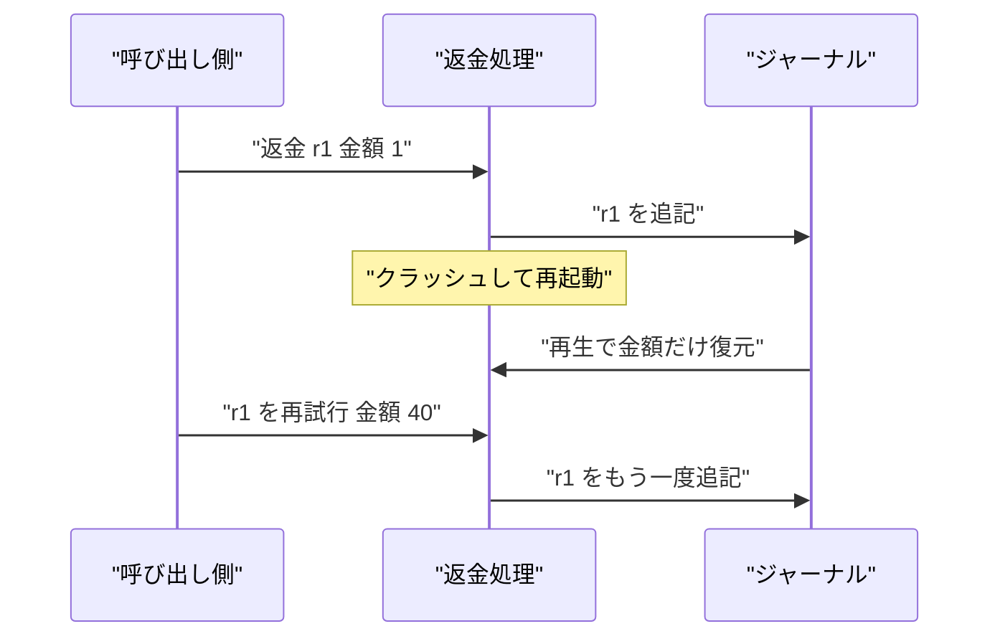

[yasaichi さんの投稿](https://x.com/_yasaichi/status/2124493123384393872)に、ドメインモデルの振る舞い、不変条件、永続化するイベント（ジャーナル）の設計を [Quint](https://quint.sh/docs/) でまとめて形式検証できる、とありました（画像は見ておらず、読んだのは本文だけです）。ただ、Web アプリの業務ルールに対して具体的に何をすることなのかが読んでもわからなかったので、イベントソーシングで返金を管理する小さな例を書いて動かしました。

やることは、状態遷移を 40 行ほどで書き、守りたい条件を 2 つ書き、ツールに反例を探させるだけです。今回は「クラッシュして復元したあと、同じ返金 ID で再試行すると返金イベントが二重に記録される」バグが、3 手の操作列として出ました。その操作列は Go のテストにそのまま移せます。

## 題材

売上額が 100 の注文に対して返金を受け付けます。返金は ID と金額を持つイベントとしてジャーナルに追記します。守りたい条件は 2 つです。

- 累計返金額が売上額を超えない
- 同じ返金 ID の確定イベントが 2 回記録されない

ジャーナルには金額も ID も入っているので、再起動後はそれを読み直して状態を復元します。バグのある設計は、復元のときに金額の合計だけ戻して、処理済み ID を戻し忘れるものです。金額の上限チェックは復元後も効くので、一見ちゃんと動いているように見えます。

## Quint で書く

Quint の仕様は「状態変数」「初期状態」「1 手の遷移」「不変条件」の 4 つでできています。ツールは遷移をいろいろな順序・引数で繰り返し適用して、不変条件が破れる状態を探します。

```qnt
module refund_bug {
  type Event = { id: str, amount: int }

  pure val SALES = 100
  pure val IDS = Set("r1", "r2", "r3")

  var journal: List[Event]   // 永続化されたイベント
  var confirmed: int         // メモリ上の確定済み返金額
  var processed: Set[str]    // メモリ上の処理済み返金ID

  action init = all {
    journal' = [],
    confirmed' = 0,
    processed' = Set(),
  }

  // コマンドの判断 + イベント適用
  action refund(id, amount) = all {
    not(processed.contains(id)),
    confirmed + amount <= SALES,
    journal' = journal.append({ id: id, amount: amount }),
    confirmed' = confirmed + amount,
    processed' = processed.union(Set(id)),
  }

  // クラッシュ後の再生。返金額は戻すが、処理済みIDを戻し忘れている
  action recover = all {
    journal' = journal,
    confirmed' = journal.foldl(0, (acc, e) => acc + e.amount),
    processed' = Set(),
  }

  action step = {
    nondet id = IDS.oneOf()
    nondet amount = 1.to(40).oneOf()
    any { refund(id, amount), recover }
  }

  val noOverRefund =
    journal.foldl(0, (acc, e) => acc + e.amount) <= SALES

  val noDuplicate =
    journal.indices().forall(i =>
      journal.indices().forall(j =>
        i == j or journal[i].id != journal[j].id))
}
```

読むときのポイントは次のとおりです。

- `all { ... }` は「全部が同時に成り立つときだけこの遷移が起きる」という意味で、先頭 2 行がコマンドの判断（ガード）、残りが状態の更新です。`x'` は遷移後の値を表します。
- `step` の `nondet` は引数の非決定的な選択、`any` は遷移の非決定的な選択です。返金と復元のどちらがどの順で起きてもよい、という書き方になります。
- クラッシュは `recover` で表しています。ジャーナル（永続化されたもの）だけが残り、メモリの状態は作り直される、というモデルです。

売上額を 100、返金額を最大 40、ID を 3 つにしたのには理由があります。最初は ID を 2 つ、金額を最大 30 にして書いたのですが、これだと返金の総額が 60 を超えられず、「累計が売上額を超えない」という条件は破りようがありません。条件が書いてあるのに何も検査していない状態でした。ID 3 つ・最大 40 なら 120 まで届くので、上限チェックが意味を持ちます。実際、金額のガード行を消した版では `noOverRefund` が破れることを確認しました。

## 反例を出す

動かした環境は Quint 0.34.0 です。`quint verify` は内部で Apalache（今回は 0.62.4 が自動で取得されました）を使い、Java が必要です。

```sh
npx quint verify refund_bug.qnt --invariants noOverRefund noDuplicate
```

出力のうち反例の部分です（`confirmed` などの状態変数を 1 行にまとめて表示されたものを、そのまま載せています）。

```
[State 0] { confirmed: 0, journal: [], processed: Set() }

[State 1]
{ confirmed: 1, journal: [{ amount: 1, id: "r1" }], processed: Set("r1") }

[State 2] { confirmed: 1, journal: [{ amount: 1, id: "r1" }], processed: Set() }

[State 3]
{
  confirmed: 41,
  journal: [{ amount: 1, id: "r1" }, { amount: 40, id: "r1" }],
  processed: Set("r1")
}

[violation] Found an issue (3594ms).
  ❌ noDuplicate
error: found a counterexample
```

流れを図にするとこうなります。



State 3 の時点で累計は 41 で、売上額 100 に対して余裕があります。だから金額のチェックは通ってしまい、`noOverRefund` は破れず、`noDuplicate` だけが破れます。「上限を守っているから大丈夫」というレビューをすり抜ける形のバグです。

なお、このモデルでは再試行の金額が元と違ってもよいことにしています（1 のあとに 40）。実際の再試行は同じ金額で来るはずなので、現実より広い条件で探しています。反例が短く読みやすいので、私はそのままにしました。

## 直す

直し方は、再生のときに処理済み ID もジャーナルから作ることです。

```sh
diff refund_bug.qnt refund_fixed.qnt
```

```
30c30
<     processed' = Set(),
---
>     processed' = journal.foldl(Set(), (acc, e) => acc.union(Set(e.id))),
```

（ほかに差があるのはモジュール名とコメントだけです。）同じコマンドで確認します。

```sh
npx quint verify refund_fixed.qnt --invariants noOverRefund noDuplicate
```

```
The outcome is: NoError
[ok] No violation found (6014ms).
You may increase --max-steps.
```

## run と verify の違い

同じ仕様に対して、コマンドが 2 つあります。[CLI のマニュアル](https://quint.sh/docs/quint)によると、`quint run` はランダムシミュレーション、`quint verify` は Apalache などによるモデル検査です。

`quint verify` は、`--max-steps`（既定は 10）までの全ての操作列を調べます。「ok」は「10 手以内には反例がない」という意味で、11 手目以降は保証しません。`--max-steps` を増やせば範囲が広がりますが、そのぶん時間もかかります。今回の仕様では、ID が 3 つ、金額が 1 から 40 という範囲の中での話です。

`quint run` は、操作列を乱数で作って不変条件を試します。速くて手軽ですが、ok が返っても「たまたま当たらなかった」可能性が残ります。バグ入りのモデルには、手元では次のように反例が見つかりました。

```sh
npx quint run refund_bug.qnt --invariants noOverRefund noDuplicate
```

`--invariants` は定義名を空白区切りで渡します。はまったのは `--seed` です。これを付けると、`quint run --help` には「`--max-samples` の既定は、`--seed` があれば 1、なければ 10000」と出ます（[マニュアル](https://quint.sh/docs/quint)の表は 10000 のままです）。つまり再現のために seed を固定すると、試行が 1 回で終わります。実際、モデルを書き直す前の版で `--seed 3 --max-steps 4` を指定したら、バグ入りなのに ok が返ってきました。seed を固定するなら `--max-samples` も一緒に指定したほうがよさそうです。

もう一つ、Java のバージョンです。[Getting Started](https://quint.sh/docs/getting-started) には JDK 17 以上と書かれていますが、手元で Temurin 17 を使ったら `UnsupportedClassVersionError`（クラスファイルのバージョン 65.0 に対して 17 は 61.0 まで）で Apalache が起動しませんでした。Temurin 21 に替えたら動きました。Apalache のバージョンが上がったために、ドキュメントの記述が古くなっているのだと思われます（Apalache 側の記載は未確認です）。

## DDD の部品との対応

返金の例で Quint のどこが DDD の何に当たるかを並べます。

| DDD の部品 | Quint | 今回の Go |
| --- | --- | --- |
| 集約が守る不変条件 | `noOverRefund`, `noDuplicate` | テストの検査項目 |
| コマンドを受けたときの判断 | `refund` の `all { }` の先頭 2 行 | `Decide` |
| イベント適用による状態変化 | `refund` の代入部分 | `Apply` |
| 再生による復元 | `recover` | `Replay` |
| 永続化 | `journal` | 永続化アダプタ |

Quint の `refund` は判断と適用を 1 つの遷移にまとめていますが、Go では `Decide`（状態を変えずにイベントを返す）と `Apply`（イベントで状態を変える）に分けるのが普通でしょう。その違いは、後で書くテストで吸収します。

イベントソーシングを使っていなくても、承認・取消・期限切れのような状態遷移は、状態変数、ガード付きの遷移、不変条件（たとえば「取消済みの注文が出荷されない」）の形に書けると思います。私が動かしたのは返金の例だけなので、こちらは見込みです。

## Go のテストに移す

反例は 3 手の操作列です。これを Go のテストにします。クリーンアーキテクチャの層で言うと、判断と適用はドメイン層（`Aggregate`）、保存してから状態に反映する順序はユースケース層、ジャーナルの読み書きは永続化アダプタの責務です。テストではユースケース層をハーネスで代用し、アダプタはスライスに差し替えます。

```go
package refund

import (
	"errors"
	"testing"
)

// ユースケース層の代役。イベントを保存してから状態に反映する。
type harness struct {
	sales   int
	journal []Event // 永続化アダプタの代役
	agg     *Aggregate
}

func (h *harness) Refund(id string, amount int) error {
	events, err := h.agg.Decide(id, amount)
	if err != nil {
		return err
	}
	h.journal = append(h.journal, events...) // 先に永続化
	for _, e := range events {
		h.agg.Apply(e)
	}
	return nil
}

func (h *harness) Crash() { h.agg = Replay(h.sales, h.journal) }

// Quint の反例: refund r1 1 → recover → refund r1 40
func TestRefundRetryAfterCrash(t *testing.T) {
	h := &harness{sales: 100, agg: New(100)}

	if err := h.Refund("r1", 1); err != nil {
		t.Fatal(err)
	}
	h.Crash()
	if err := h.Refund("r1", 40); !errors.Is(err, ErrDuplicate) {
		t.Fatalf("2回目の err = %v, want ErrDuplicate", err)
	}
	if len(h.journal) != 1 {
		t.Fatalf("journal = %v, want 1 event", h.journal)
	}
}
```

照合しているのは、再試行がエラーになること（Quint では遷移が起きないこと）と、ジャーナルが 1 件のままであること（Quint の `noDuplicate`）です。対象の実装は、Quint のバグ版と同じく「`Replay` が金額しか戻さない」ものと、修正版（`Replay` が各イベントに `Apply` を適用する）の 2 つを用意しました。

```go
// バグ版: 処理済み ID を戻し忘れている
for _, e := range journal {
	a.confirmed += e.Amount
}

// 修正版
for _, e := range journal {
	a.Apply(e)
}
```

Go 1.26.11 で実行した結果は次のとおりです。バグ版は落ち、修正版は通りました。

```
--- FAIL: TestRefundRetryAfterCrash (0.00s)
    refund_test.go:38: 2回目の err = <nil>, want ErrDuplicate
FAIL
```

```
ok  	example.com/refund/refund	0.001s
```

操作列の移し方は、今回は手で写しました。Quint には `--out-itf` で反例を JSON（Informal Trace Format）として出す機能があり、`quint run --mbt` で各ステップで選ばれた遷移や引数の情報も付けられます。ただ、[Getting Started](https://quint.sh/docs/getting-started)が紹介しているテスト用の Quint Connect は Rust 向けで、Go 向けの同等のものは見つけられませんでした。Go で自動化するなら、ITF の JSON を読んでテーブルテストに流し込む自前のコードが要りそうです。

## どこまで保証されているか

確認できたのは、アプリ内の返金イベントについての 2 つの条件だけです。モデルには決済事業者が出てこないので、保存と送信の間でクラッシュしたときに外部へ二重送信されるかどうかは、何も言えません。これを保証するには、送信の失敗と再送をモデルに足し、実装側でも冪等キーの扱いを確かめる必要があります。

同時書き込みも同じです。このモデルは 1 手ずつ順番に動くので、同じ返金 ID のリクエストが同時に来た場合は扱えません。書き込みの競合を遷移として足し、実装側でもトランザクションや一意制約の挙動を検証することになります。

さらに、保存する前にクラッシュしてイベントが残らないケースも入っていません。`refund` は保存とメモリ更新を一度に行う前提で書いてあります。

## レビューの負担はどこまで下がるか

[以前の記事](https://blog.swallowarc.jp/posts/2026-11-19-coding-agents-review-bottleneck/)では、エージェントを入れるとレビュー待ちが伸びるという論文の解説を紹介しました（論文本体は読んでいません）。実装を人が全部読む前提では、PR が増えるほど詰まります。モデルとテストがあれば、人が見る対象を次の 3 つに絞れる、というのが私の見立てです。

1. 不変条件が妥当か（「累計が売上額を超えない」だけで足りるか、「同じ ID が二重に記録されない」を忘れていないか）
2. モデルが置いている障害の前提（どこでクラッシュすると仮定しているか。上の「保存前のクラッシュ」のような抜けがないか）
3. モデルと実装を結びつけるテスト（反例の操作列が、実際に実装を通っているか）

エージェントが書いた実装の細部は、テストが通っていれば人が一行ずつ追わなくてもよくなる可能性があります。下がるのは「実装が仕様どおりか」を読む負担で、「仕様が正しいか」を読む負担は残ります。どのくらい下がるかを示す数字は持っていません。

CI には、`quint verify`（Node と JDK 21 が要ります）と `go test ./...` を同じジョブに並べるだけで足ります。モデルを壊す変更は前者が、移したテストを壊す実装の変更は後者が落とします。ただし、モデルと実装のずれ自体はどちらも検出しません。モデルだけ直して Go のテストを移し忘れても CI は通ります。

## 導入するなら

仕様と実装を別々に保守するコストは、確実に増えます。今回の例でも、Quint が 45 行ほど、Go が 50 行ほどあり、どちらも変更のたびに直す対象になります。

そのため、導入を考えるなら、失敗したときの影響が大きく、操作の組み合わせも多いユースケースから始めるのが現実的だと思います。返金・課金・在庫の引当のように、金額や数量に直結して、クラッシュ・再試行・取消が絡むところです。単純な CRUD に入れても、モデルが実装の写しになるだけで、反例が出る余地がありません。

## 出典

- [yasaichi さんの投稿（X）](https://x.com/_yasaichi/status/2124493123384393872)（本文は fxtwitter 経由で確認: https://api.fxtwitter.com/_yasaichi/status/2124493123384393872）
- [Quint ドキュメント](https://quint.sh/docs/)
- [Quint: Getting Started](https://quint.sh/docs/getting-started)
- [Quint: CLI Manual](https://quint.sh/docs/quint)
- [以前の記事: コーディングエージェントでコードは3割増えたのに、レビュー待ちも5割伸びたという論文](https://blog.swallowarc.jp/posts/2026-11-19-coding-agents-review-bottleneck/)
