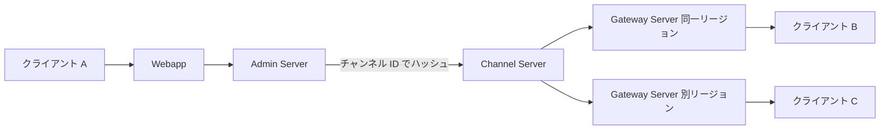

メモリに状態を持つサーバーが 10 台あって、そのうち 1 台が落ちたら、担当を割り振り直す必要があります。このとき担当が変わるチャンネルがどれくらいになるのかを、手元で数えてみました。チャンネル 10 万個で試すと、`hash(id) % 台数` で決めていた場合は約 90%、consistent hashing の場合は約 9% でした。

きっかけは、Slack のエンジニアリングブログの[リアルタイムメッセージングの記事](https://slack.engineering/real-time-messaging/)です。この記事では、まさにこの方式でチャンネルをサーバーに割り当てています。まず記事の内容を整理して、そのあとに実験の中身を書きます。

## メッセージが届くまで

登場するサーバーは 4 種類で、Java 製だと書かれています。

- Channel Server(CS): チャンネルの履歴を一部メモリに持ち、割り当てられたチャンネルのメッセージを扱う。ピーク時は 1 ホストで約 1600 万チャンネル
- Gateway Server(GS): ユーザーの WebSocket 接続と購読を持つ。複数リージョンに置かれ、クライアントは最寄りに接続する
- Admin Server(AS): ステートレス。Webapp と CS の間をつなぐ
- Presence Server(PS): オンライン状態を持つ。ユーザー ID のハッシュで割り当てる

担当をハッシュで決めているのは CS と PS で、状態を大量に持つのはこの 2 つです。GS は接続の近さで決まり、AS は状態を持たないので、どちらもハッシュとは関係がありません。ここでいう「チャンネル」は、普通の Slack チャンネルのほかに、ユーザーやファイルなどの ID も含みます。

メッセージ送信の流れは次のとおりです。



起動時に GS が、ユーザーの全チャンネルについて担当の CS を引いて購読しておきます。だから送信時は、AS が CS を 1 台引けば、あとは購読している GS に配るだけで済みます。タイピング中の表示のように DB に保存しないイベントは、Webapp と AS を通らず、クライアントから GS が受けて CS に渡します。

## 落ちたときの影響

著者は、consistent hash ring を管理する CHARM というコンポーネントが、不健康な CS を素早く置き換えると書いています。新しい CS は 20 秒未満で受け付け可能になるそうです。1 チームのチャンネルは全 CS に散らばっているので、1 台入れ替えても各チームで影響を受けるのはごく一部で、遅延が上がるのも 20 秒未満だと説明しています。

## 10 台から 1 台減らす実験

リングは 1 台あたり仮想ノード 100 個、ハッシュは SHA-256 の先頭 64 ビットにしました。Python で書いています。

```python
import hashlib, bisect

def h(s):
    return int(hashlib.sha256(s.encode()).hexdigest()[:16], 16)

def build(nodes, vn=100):
    r = sorted((h(f"{n}#{i}"), n) for n in nodes for i in range(vn))
    return [x[0] for x in r], [x[1] for x in r]

def look(ring, k):
    ks, ns = ring
    i = bisect.bisect(ks, h(k)) % len(ks)
    return ns[i]

chans = [f"C{i}" for i in range(100000)]
nodes = [f"cs{i}" for i in range(10)]
after = nodes[:-1]
r1, r2 = build(nodes), build(after)
print("ring moved:", sum(look(r1, c) != look(r2, c) for c in chans) / len(chans))
print("mod moved:", sum(nodes[h(c) % 10] != after[h(c) % 9] for c in chans) / len(chans))
```

```
ring moved: 0.09107
mod moved: 0.89954
```

リングで動いたのは約 9% で、落ちた 1 台が持っていた 1/10 にほぼ一致します。剰余では約 90% が動きました。CS のように履歴をメモリに持つ構成で剰余を使うと、1 台落ちただけで、ほぼ全チャンネルの履歴の持ち主が変わってしまいます。

この実験が見ているのは割り当ての移動量だけです。Slack がこの 2 つを比べて選んだという話は、記事には出てきません。

## 自分のサービスに持ち帰るなら

メモリに状態を持つノードを並べるなら、担当はキーのハッシュで決めます。ここで顧客単位ではなくキー単位にしておくと、Slack のように 1 チームの負荷や障害が 1 台に集中しません。

記事は 2023 年 4 月のもので、今の構成が同じかはわかりません。また、CS が落ちたあとに履歴をどう復元するか、GS が購読を張り直す詳細は書かれていません。

## 出典

- [Real-time Messaging - Engineering at Slack](https://slack.engineering/real-time-messaging/)
