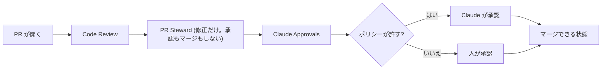

昨日（11 月 23 日）に Anthropic が [Claude Ship](https://claude.com/resources/articles/introducing-claude-ship) をベータで出しました。「PR のレビュー、修正、承認を Claude がやる」という説明だけでは、どこまで自動で進むのかがわかりにくかったので、公式ドキュメントを読んで整理しました。

## 3 つの部品

Claude Ship は、PR が開いたあとの作業を 3 つに分けた部品の総称です。

- Code Review: PR を読んで指摘をつける。3 月に出ていて、10 月に一般提供（GA）になっています。
- PR Steward: CI の失敗、マージコンフリクト、レビューコメントに対応して、修正を push する。ベータです。
- Claude Approvals: リポジトリ内のポリシーファイルに従って、承認してよい PR かどうかを判定する。ベータです。



[公式ドキュメント](https://code.claude.com/docs/en/claude-ship)によると、マージを止めたい条件は GitHub のブランチ保護で別に掛けます。Approvals のチェックは、それを必須チェックにして初めてマージを止めます。

対象は GitHub のリポジトリで、Claude の Team か Enterprise プランが必要です。Zero Data Retention、HIPAA 構成、顧客管理の暗号鍵を使っている組織では使えません。

## 個人で試すなら /ship

Claude Code で `/ship` を打つと、自分の PR だけで試せます。[ドキュメント](https://code.claude.com/docs/en/ship-command)では、変更のコミットと push、PR の作成、`/code-review` によるレビューまでを進め、そのあと PR の「watch」に入ります。watch は、失敗した CI、コンフリクト、コメント、指摘に対応して push し続ける状態です。マージは自分でやります。Claude Code 2.1.330 以降、GitHub CLI 2.63 以降、git 2.38 以降が必要です。

動かす前に押さえておきたいのは次の 3 点です。

- 確認なしで進みます。コミットと push の直前に「Esc で中止」の 1 行が出て、何もしなければ数秒後に続行します。`.env` のように名前が秘密っぽいファイルは検出されますが、見ているのは名前だけで、中身は自分で確かめることになります。
- watch はセッションの中で動くので、セッションを前面で開いたまま、PC を起こしたままにします。`/clear` やブランチの切り替え、Esc で終わり、放っておいても 7 日で終わります。
- Claude が自分の判断で動くとき、Claude Code は merge、approve、auto-merge の有効化、force push を止めます。ただしドキュメント自身が、ブランチ保護が許すなら、あなたのログインで他の人の承認なしにマージできる PR はマージできてしまう、と書いています。禁止コマンドだけに頼らず、ブランチ保護の側で止めておく話です。作業は自分の名前で GitHub に出ます。

## 組織で入れるときの順番

公式が勧めるのは、1 リポジトリずつ、エージェントを 1 つずつ足す進め方です。

1. Code Review を入れ、月の上限額を決めて、1 レビューあたりの平均コストを見る
2. PR Steward を入れる。起動は最初「Manual」にして、コメントで `@claude steward` と頼んだときだけ動かす
3. Claude Approvals のポリシーファイルを置く。最初は observe モードにする

observe モードでは、Approvals のチェックが「このポリシーならこう判定する」と表示するだけで、何も承認しません。人間のレビュアーの判断と見比べて、揃ってきたら enforce にして、GitHub 側でそのチェックを必須にします。

ポリシーは `.claude/approvals.yml` に書きます。[ポリシーファイルの仕様](https://code.claude.com/docs/en/approvals-policy)にある出発点の例です。

```yaml
# .claude/approvals.yml
version: 1
mode: observe
rules:
  - purpose: "A change takes two people. When Claude's review passes, one is enough and Claude approves."
    paths: ["**"]
    verdict: { claude: comments, seats: 2 }
    override:
      - { if: "claude/code_review = pass", verdict: { claude: approves, seats: 1 } }
  - purpose: "A change to the review rules takes two people."
    paths: ["**/.claude/**"]
    nested: inherit
    verdict: { claude: comments, seats: 2 }
```

普通は 2 人の承認が要り、Code Review が通れば 1 人で足りて Claude が承認します。レビューのルール自体（`.claude/` 以下）の変更は、常に 2 人です。公式は「賢い CODEOWNERS」と呼んでいて、パスだけでなく、自然言語で書く classifier も条件に使えます。

注意したいのは、このファイルがデフォルトブランチに入ると、Code Review の自動実行の対象が変わることです。ドキュメントによると、`claude/code_review` を名指しするルールがない PR では、自動レビューが基本的に止まります。すでに Code Review を使っているリポジトリに observe モードで足したつもりで、レビューが走らなくなる、ということが起こりえます。

## 課金

トークン従量で、プランの利用枠とは別に、組織の usage credits から引かれます。エージェントごとに整理するとこうなります。

- Code Review: 管理者が上限額を決められる
- PR Steward: 上限は自分で設定するまでありません
- Claude Approvals: 基本料金はなし。ポリシー内の classifier はトークン分が課金され、Claude のレビューを条件に使うと、observe モードでも課金対象の Code Review が走る
- `/ship`: 通常の Claude Code の利用として数えられる

## 効果についてわかっていること

Anthropic は、自社の Claude Code チームで、マージされた PR の数が 6 月から 9 月で 2 倍以上になり、revert された割合が 40% 以上下がったと[書いています](https://claude.com/resources/articles/introducing-claude-ship)。ただしこれは Code Review 単体の数字でもなく、Ship 全体の数字でもなく、「より広いプロセスの 1 層としてのレビュー」の結果だと、同じ記事が断っています。Ship 全体の効果を示す数字は、私が読んだ範囲では見つかりませんでした。

[ZDNET](https://www.zdnet.com/innovation/claude-ship-code-how-to-try) には、書くのと同じ速さで出荷するという発想に不安を覚える、という編集者のコメントも載っています。私なら、最初のポリシーは [Digital Trends](https://www.digitaltrends.com/computing/anthropic-claude-ship-code-review) が例に挙げている「ドキュメントだけの変更は Claude が承認してよい」くらいに絞って、observe モードで人間との判定のずれを数えてから広げます。

私は Claude Ship を自分の手で動かしていません。ここまでは公式ドキュメントと報道に基づいています。

## 出典

- [Introducing Claude Ship（Anthropic）](https://claude.com/resources/articles/introducing-claude-ship)
- [Claude Ship 製品ページ](https://claude.com/product/claude-ship)
- [Claude Ship（Claude Code Docs）](https://code.claude.com/docs/en/claude-ship)
- [/ship and /steward（Claude Code Docs）](https://code.claude.com/docs/en/ship-command)
- [Claude Approvals policy file reference（Claude Code Docs）](https://code.claude.com/docs/en/approvals-policy)
- [Claude can ship code for you now - how to try it（ZDNET）](https://www.zdnet.com/innovation/claude-ship-code-how-to-try)
- [Anthropic expands Claude Code's review tools（Digital Trends）](https://www.digitaltrends.com/computing/anthropic-claude-ship-code-review)
- [Claude AI can review pull requests and ship fixes on its own now（The Verge）](https://www.theverge.com/ai-artificial-intelligence/1040134/anthropic-claude-ship-ai-pull-requests)
