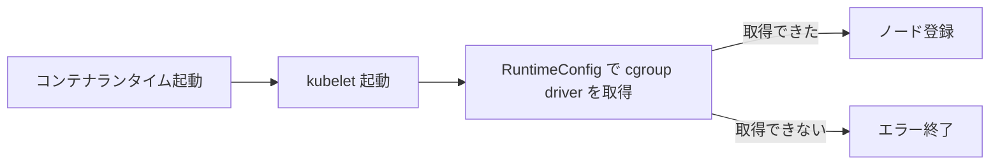

Kubernetes v1.38 は 2026 年 12 月 16 日リリース予定で、予告記事の [Kubernetes v1.38 Sneak Peek](https://kubernetes.io/blog/2026/11/23/kubernetes-v1-38-sneak-peek/) が出ました。読んでみると、新機能よりアップグレードで引っかかりそうな変更のほうが多かったので、そちらを順に書きます。予告記事は内容が変わりうると断っているので、確定版はリリースノートで確かめてください。

## kubelet が cgroup driver をランタイムに尋ねるようになる

v1.38 の kubelet は、cgroup driver を設定ファイルの `cgroupDriver` ではなく、コンテナランタイムに CRI の `RuntimeConfig` RPC で尋ねて決めます。従来の方法は既定で使えなくなります。

ランタイムが先に動いていないと、kubelet はリトライのあとノード登録の前に終了します。RPC に対応していない古いランタイムも同じ経路に入ると思われます（予告記事が明記しているのは kubeadm の preflight がエラーを出すことです）。古いランタイムのノードや、起動順が決まっていない構成では、アップグレード後にノードが戻ってこない可能性があります。

設定まわりも変わります。

- 設定ファイルに `cgroupDriver` が書いてあると、kubelet はそれを拒否します。一時的な feature gate の `LegacyCgroupDriverFallback` を有効にすれば従来どおり動かせます。
- kubeadm は `cgroupDriver` を `systemd` にする既定をやめます。

詳細は [KEP-4033](https://kubernetes.dev/resources/keps/4033) にあります。私なら、まず自分のノードのランタイムが `RuntimeConfig` に対応しているかを見ます。設定ファイルの 1 行だった項目が、ランタイムの対応状況と起動順に依存する形になるからです。

## そのほか、設定やスクリプトを見直す箇所

- kubectl の環境変数 `KUBECTL_REMOTE_COMMAND_WEBSOCKETS` と `KUBECTL_PORT_FORWARD_WEBSOCKETS` が削除されます。WebSocket を切って SPDY に戻すための変数でした。今後は WebSocket を先に試し、必要なら SPDY にフォールバックします。CI やスクリプトで設定していても、無視されるだけです。
- kuberc（kubectl の個人設定ファイル）は v1.38 で stable になる見込みです。新しい `kubectl.config.k8s.io/v1` では、認証プラグイン許可リストの `name`（`command` の別名）が使えなくなります。v1.36 から非推奨なので、`command` に書き換えておけば済みます。参照は [KEP-3104](https://kubernetes.dev/resources/keps/3104) です。
- `LimitedSwap` のノードで Pod レベルのリソース指定を使っていると、v1.38 から Pod の memory request と limit が等しい Pod にはスワップが割り当てられなくなります。コンテナ側で request を limit より低くしていても同じです。スワップに頼るワークロードがあれば先に確認してください。
- cgroup v1 は、v1.35 から kubelet が既定で起動を拒否しています。`failCgroupV1: false` で回避できますが、この設定は v1.38 にも残るものの、予告記事は一時しのぎと書いていて、将来は削除される予定です。
- admission webhook は、v1.37 から TokenReview や SubjectAccessReview などの仮想リソースへの書き込みを受け取らなくなっています（feature gate `ExcludeAdmissionWebhookVirtualResources` が既定で有効）。v1.38 で新しく起きる変更ではありませんが、これらを監視する webhook があれば、すでに届いていない可能性があります。gate を切れば戻せます。ただし stable になるとロックされる予定です。

## 新機能

stable になる見込みなのは、kuberc、Pod レベルのリソース指定、DRA の partitionable devices（GPU を丸ごとでも分割でも扱える仕組み）です。alpha で入る EvictionRequest API は、ノードのドレインなどで Pod を落とす前に、アプリケーション側が後片付けやデータ移行をできるようにするものです。応答がなければ、PDB を尊重する従来の eviction に戻ります。使うには feature gate と alpha の API グループの両方が必要です。

## 出典

- [Kubernetes v1.38 Sneak Peek](https://kubernetes.io/blog/2026/11/23/kubernetes-v1-38-sneak-peek/)（Kubernetes、2026-11-23）
- [KEP-4033: Discover cgroup driver from CRI](https://kubernetes.dev/resources/keps/4033)
- [KEP-3104: Separate kubectl user preferences from cluster configs](https://kubernetes.dev/resources/keps/3104)
- [KEP-4563: EvictionRequest API](https://kubernetes.dev/resources/keps/4563)
