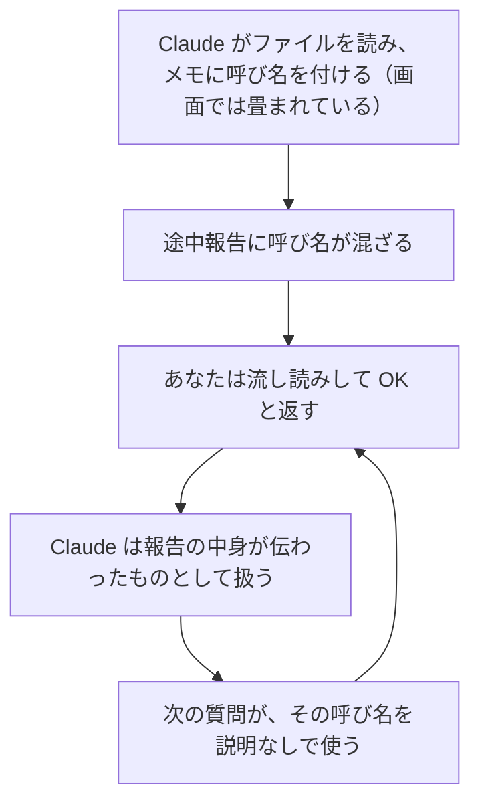

Claude Code の質問の意味がわからず、自分のほうがおかしくなったのかと思うことがある、という相談をもらいました。原因を調べて、手元で `claude -p` を 43 回呼ぶ小さな実験をしたので、その報告です。

先に結果を書きます。途中報告に「OK 進めて」と返したセッションでは、その報告に出ていた Claude の造語が、次の質問に 4 回中 4 回、説明なしで使われました。「OK」の代わりに「そっちで付けた名前はわからない」と一言添えたセッションでは、造語は 4 回中 4 回、質問から全部消えました。私はここから、質問が読めなくなる原因のかなりの部分は、こちらが返している「OK」にあると考えています。

## 会話は「伝わった証拠」を積んで進む

この現象を説明する道具が、会話研究にあります。Herbert Clark と Susan Brennan が 1991 年に書いた [Grounding in Communication](https://collablab.northwestern.edu//CollabolabDistro/nucmc/ClarkAndBrennan-GroundingInCommunication-1991.pdf) という章です。二人の知識のうち「お互いに知っていると、お互いにわかっている」部分を common ground（共通基盤）と呼び、発言をそこへ加えていく作業を grounding と呼んでいます。

著者たちの主張で私が大事だと思ったのは、質問は口にしただけでは質問にならない、という点です。相手が理解したことが確かめられて、はじめて質問したことになります。その確かめ方として、話し手は「誤解された形跡がない」だけでは満足せず、理解されたという積極的な証拠を探す、と著者たちは書いています。証拠の代表は 3 つで、相づち、話の流れに合った次の発言、途切れない注意（視線など）です。

これを Claude Code に当てはめてみます。ここからは私の読みです。ターミナルには相づちも視線もありません。残る証拠は「話の流れに合った次の発言」だけで、長い途中報告に対する「OK 進めて」がちょうどそれに当たります。こちらは「進めてよい」と言っただけのつもりでも、会話の決まりごととしては、報告の中身が伝わった証拠として働きます。



同じ章に、冗長さの説明になりそうな話もあります。著者たちは、ポンプの組み立てを電話で教える場合とキーボードで教える場合を比べた Cohen の研究を引いています。電話では「青い小さなキャップがあるよね」「うん」と部品を確認してから指示を出すのに、キーボードでは部品の特定と指示を 1 回の発言に詰め込んでいました。著者たちの説明では、キーボードは発言を作るのも話者を交代するのも高くつくので、1 ターンに多くを詰めるようになります。Claude Code とのやり取りは 1 往復が重いので、報告も質問も 1 回に全部載せた形になりやすい、と私は考えています。

もう一つ、聞き手が言い出す訂正は、話し手が自分で直すより手間がかかる、という指摘があります。40 行の報告の途中に出てきた「R系」が何なのかを聞き返すのは面倒で、たいてい聞かずに OK を返します。その 1 回ごとに、Claude が想定する共通基盤は実際より広くなります。

## 実験: 「OK」を返した呼び名だけが、説明なしで出てくるか

確かめるために、セッションの記録を作文しました。Go の注文 API で起きている二重課金を調べて直す、という設定です。記録には、ユーザーの最初の依頼（1 行）、ツールの実行結果、Claude が自分用に付けたメモ、途中報告とそれへの返事が入っています。メモの中で Claude は次のような呼び名を付けています。

```text
[note] 41 件を 2 系統に分ける。R系 = payment client のリトライ起因（1 つの order に charge が 2 本）。
       S系 = 送信側起因（order 自体が 2 本できていて、それぞれに charge が 1 本）。
[note] R系は案A で潰せる。案A = doCharge で order_id を Idempotency-Key として送る。
…
[assistant] 調査の途中経過です。（中略）原因は 2 系統あり、R系（決済クライアントのリトライ起因）が 32 件、
            S系（送信側起因）が 9 件です。（中略）まず案A の実装に進んでよいでしょうか。
[user] OK 進めて
…
[note] これをパス2と呼ぶ（B' の窓 1 分版）。
```

記録の最後で、業務上の判断（同じ内容の再注文を黙って 1 件にまとめてよいか）が必要になります。ここで「ユーザーへ送る次のメッセージを書いて」と頼みました。R系・S系・案A は途中報告に一度出てユーザーが OK を返した呼び名、案B・パス2 はメモにしか出てこない呼び名です。

実行は次の形です。[CLI リファレンス](https://code.claude.com/docs/en/cli-reference.md)によると、`--safe-mode` は CLAUDE.md、hook、スキル、出力スタイル、自動メモリを読み込みません。`--tools ""` で組み込みツールも切り、空のディレクトリで動かしました。

```sh
claude -p --safe-mode --tools "" --model sonnet --no-session-persistence < session.txt
```

`sonnet` は実行時点で Sonnet 5.5、Claude Code は 2.1.331 でした。条件ごとに 4 回ずつ実行し、質問文に呼び名が出てくるかを文字列検索で数えました。

| 記録の内容 | R系 | S系 | 案A | 案B | パス2 | 文字数 |
|---|---|---|---|---|---|---|
| 報告に呼び名あり、返事は「OK 進めて」 | 4/4 | 4/4 | 4/4 | 4/4 | 4/4 | 1118〜1386 |
| 報告を呼び名なしに書き換え、返事は「OK 進めて」 | 1/4 | 0/4 | 1/4 | 3/4 | 2/4 | 994〜1178 |
| 報告に呼び名あり、返事で「その名前はわからない」と伝える | 0/4 | 0/4 | 0/4 | 0/4 | 0/4 | 981〜1204 |

1 行目の質問文は、たとえばこう始まります。

```text
二重課金 41 件のうち R系 32 件はこれで止まるはずです。残りの S系 9 件は、クライアントの二度押しや
モバイルの自動再送で POST /orders が 2 回届き、注文自体が 2 本できているのが原因です。
```

R系が何かは、この質問文のどこにも書かれていません。一方、メモにしか無かった案B とパス2 は、「案B（正攻法）: クライアントが注文ごとに UUID を…」のように、説明の付いた選択肢の名前として出てきました。4 回のうち 1 回だけ、パス2 の説明が「B' の窓を 1 分に縮めたもの」と、別の呼び名に寄りかかっていました。

2 行目では、途中報告を「リトライで 1 つの注文に課金が 2 回走ったものが 32 件」のように呼び名なしで書き換えました。メモの中身は同じです。すると R系・S系はほぼ出なくなりました。Claude は、自分がユーザーに見せたものと見せていないものを区別していて、見せて OK をもらった呼び名だけを説明抜きで使っている、と私は読みました。各 4 回なので、傾向として受け取ってください。

## 明日からやること 1: OK に「わかっていないこと」を一言添える

3 行目が、いちばん安く効いた方法です。途中報告への返事を次の文に差し替えただけです。

```text
進めていいよ。ただ、R系とか S系とか案A とか、そっちで付けた名前で言われても何のことかわからない。
```

この返事のあとに書かれた質問文では、名指ししなかった案B・パス2 も含めて、呼び名が 4 回とも出ませんでした。選択肢は「方針1: クライアントが注文ごとに固有IDを送り、サーバが重複を拒否する」のように中身で書かれています。

報告を全部読んで理解する必要はありません。読んでいないなら「報告は流し読みした」と、わからない語があったなら「この名前はわからない」と、進めてよいという返事に足すだけです。Clark と Brennan の言葉でいえば、積極的な証拠の代わりに、理解していないという証拠を渡すことになります。

ただ、この返事で文字数は減りませんでした（981〜1204 字）。呼び名の問題と長さの問題は別で、長さには後で触れる別の手当てが要ります。

## 明日からやること 2: 答える前に、自分の理解を言い返す

質問が届いてしまった後の話です。Clark と Brennan は、何を指しているかを確かめる技として、聞き手が別の言い方で言い直してみせる方法を挙げています。電話番号の問い合わせでは、客が番号を復唱して確かめた割合が 7 割を超えた、という調査も引かれています。

これを質問への返事でやってみました。1 行目の条件で出てきた質問文（呼び名だらけのもの）に対し、わざと 2 か所間違えた理解を返します。

```text
自分の理解を書くので、違っていたら直して。残ってるのはボタン二度押しとかで注文が 2 件できるやつで、
サーバ側で 1 分以内の同じ注文をまとめれば 9 件全部止まる。「もう一度注文」は別のボタンだから
影響しない。で、アプリ側の対応が出たらサーバ側のは外す。合ってるなら両方で進めて。
```

正しくは、止まるのは 9 件中 8 件で、「もう一度注文」ボタンは影響を受けます（1 分以内に押すと、注文できたように見えて 2 個目が届きません）。後者は判断そのものに関わる誤解です。

4 回実行して、4 回とも 2 か所の間違いが両方指摘され、判断が要るサーバ側の変更には着手しませんでした（1 回は、どちらに転んでも必要なクライアント側の対応だけ先に始めると書いていました）。「合ってるなら進めて」に流されて、誤解したままの方針で進めた回はありません。同じ誤解を抱えたまま「両方で」とだけ返していたら、Claude の側には誤解に気づく材料がありません。

言い返すのは手間に見えますが、私は、わからない質問を読み解こうとして固まっている時間よりは短いと思います。間違っていてかまわないので、書けるところまで書いて直させます。

自分の「わかった」という感覚が当てにならない、という研究もあります。Keysar と Henly の実験（[論文の要旨](https://pubmed.ncbi.nlm.nih.gov/12009039/)、[シカゴ大学の紹介記事](https://chronicle.uchicago.edu/020509/keysarresearch.shtml)）では、あいまいな文を読み上げた話し手が「伝わった」と思った場合の 46% が実際には伝わっていませんでした。紹介記事によると、聞き手のほうも、誤解しているときと正しく理解しているときで自信の強さが変わらなかったそうです。人間同士、それもあいまいな文に限った実験なので、Claude にそのまま当てはまるとは言えません。それでも、話が噛み合わないことが、どちらかの頭がおかしい証拠にならないのは確かだと思います。

## 明日からやること 3: 「私に見せたのはどれか」を仕分けさせる

言い返すほどの材料もないときは、質問に出てくる語を仕分けさせます。

```text
返事の前に確認させて。いまの質問に出てくる呼び名と数字を、(a) 私の発言に出てきたもの、
(b) あなたが前に私へ送った文章に出てきたもの、(c) この質問で初めて私に見せたもの、に分けて一覧にして。
```

3 回実行して、3 回とも仕分けは記録と合っていました。R系・S系・案A は (b)、案B・パス2 と判断材料の数字（23 件、14 件、2 件など）は (c) に入ります。3 回とも、頼んでいないのに「パス2 は作業メモで付けた呼び名で、定義を見せないまま使っていた」と自分から書き添えてきました。(c) の一覧が、この質問を読むために新しく飲み込むべきものの全量です。

聞き方には注意が要りました。最初は「あなたのメモやツール結果にしか無いもの」を挙げさせる文面にしていて、これは 4 回とも安全装置に止められ、API エラーになりました（表示は `reasoning_extraction`）。記録の中にメモを貼り付けた私の実験の形が原因かもしれず、実際のセッションで同じことが起きるかは確かめていません。「私に見せたかどうか」で聞く文面のほうは通りました。

実際のセッションでは、これは `/btw` に向いた質問だと思います。[公式ドキュメント](https://code.claude.com/docs/en/interactive-mode.md)によると、`/btw` は会話全体を見て答え、やり取りは会話履歴に残りません。ただし私は `claude -p` で試しただけで、`/btw` の上では試していません。

## 常設するなら: CLAUDE.md に書く指示を 2 種類比べた

毎回言うのが面倒なら、指示として置いておけます。2 種類を試しました。1 行目の条件（呼び名あり、返事は OK）の記録に対して、`--append-system-prompt` で指示を足しています。CLAUDE.md に書いた場合と読み込まれ方が同じとは限らない点は割り引いてください。

一つは、書き方の規則を並べたものです。

```text
ユーザーに質問するときの書き方:
1) 最初の1文で「何を決めてほしいか」を言う。
2) 作業中に自分が付けた呼び名は使わず、中身で説明する。
3) 選択肢ごとに「選ぶと何が起きるか」を1行で書く。
4) 自分のおすすめと理由を1つ添える。
5) ユーザーが知らなそうな用語は1行で定義する。
全体で10行以内。
```

もう一つは、規則を書かずに、読み手の状態だけを説明したものです。

```text
ユーザーについて:
ユーザーはあなたに作業を任せている間、別の仕事をしている。あなたが読んだファイル、実行した
コマンドの結果、自分用のメモは見ていない。あなたの途中報告は流し読みしていて、「OK」と返して
いても、報告の中で出てきた呼び名や数字を覚えているとは限らない。ユーザーが確実に知っているのは、
ユーザー自身が書いた発言の内容だけである。
判断を求めるメッセージは、この状態のユーザーが、それ単体で読んで決められるように書く。
```

どちらも 4 回中 4 回、R系・S系・案A・案B・パス2 が質問文から消えました。違いは長さです。規則のほうは 444〜462 字で、指示なしの 3 分の 1 ほどになり、1 文目に決めてほしいことが来ます。読み手の説明のほうは 837〜942 字で、数字の根拠（どの集計から出た件数か、1 分に絞った理由）が残りました。

どちらが速く決められるかは、この実験では測れていません。私の好みを言うと、判断の中身がわかっている領域なら規則のほう、根拠まで見て決めたい判断なら読み手の説明のほうです。

長さについては、Claude Code に組み込みの `Concise` 出力スタイルもあります。[出力スタイルのドキュメント](https://code.claude.com/docs/en/output-styles.md)によると、応答の 1 文目に結果を置き、前置きと経過説明と最後の要約を省くスタイルです。こちらは試していません。

指示は置いたら終わり、とはいきません。同じドキュメントは、出力スタイルは Claude が従う指示であって、必ずそうなる保証ではないと断っています。[Claude の文体を嘆く Hacker News のスレッド](https://news.ycombinator.com/item?id=49388752)にも、コンテキストが伸びると規則を忘れる、コンパクトの直後に元の冗長な書き方に戻った、という報告があります。私の実験は 1 回きりの呼び出しなので、長いセッションで指示が持つかどうかは確かめられていません。指示が効かなくなったときは、会話の中で言う「その名前はわからない」の一言に戻ればよいと考えています。

## 文脈のない読み手に読ませる方法は、数では測れなかった

Anthropic の[プロンプトの手引き](https://platform.claude.com/docs/en/build-with-claude/prompt-engineering/claude-prompting-best-practices)には、プロンプトを書いたら、その作業をほとんど知らない同僚に見せて、戸惑うようなら Claude も戸惑う、という確認方法が載っています。向きを逆にして、Claude の質問文を文脈のない読み手に読ませれば、質問の読みにくさを測れるのではないかと考えました。

指示なし・規則・読み手の説明の 3 条件で書かれた質問文 12 本を、別のモデル（haiku、システムプロンプトは差し替え）に読ませました。渡したのは最初の依頼 1 行と質問文だけです。「何を決めるよう求められているか」と「説明なしに使われていて意味を確定できない語」を答えさせています。

結果は期待と違いました。「意味を確定できない語」の数は、指示なしで 4・4・5・10 個、規則で 8・8・6・6 個、読み手の説明で 5・4・6・7 個でした。指示を入れても減っていません。読み手役のモデルは、どんな文章を渡しても 4 個以上は何かを挙げてきます。数を点数として使うのは無理でした。

使えたのは、挙げられた語の中身です。指示なしの 4 本では、4 本とも「R系」が挙がりました。指示ありの 8 本では、セッション内の呼び名はほぼ挙がらず、代わりに「同一カートとは、どこまで同じなら同一なのか」「残り 9 件と月 9 件ペースは同じ期間の数字か」といった、判断する人なら実際に聞きたくなる点が並びました。特に 10 行に収めた規則のほうで目立ちます。短くした分、数字の素性が落ちているということだと思います。

「何を決めるよう求められているか」は、私が読んだ限り 12 本すべてで合っていました。指示なしの質問文でも、決めることそのものは読み手役に伝わっています。伝わらなかったのは、すでに何が直っていて何が残っているか、という背景でした。

Claude Code の中でこれをやるなら、読み手役はサブエージェントになります。ドキュメントの説明では、サブエージェントは渡されたプロンプトから始まり、`/btw` は会話全体を見ます。文脈のない読み手として使えるのはサブエージェントのほうです。ただ、読み手役の指摘を戻して書き直させるところまでは試していません。先ほどの Hacker News のスレッドには、コードコメントについて同じことを試した人がいて、あまり助けにならなかったと書いています。私は、毎回通す仕組みにするより、質問がどうしても読めないときに一度だけ使うくらいが合っていると思います。

## この実験でわからないこと

作文した記録 1 本を 1 回の呼び出しで渡しているので、本物の長いセッションとは違います。場面は 1 つ、各条件 4 回（仕分けは 3 回）、書き手は Sonnet だけです。呼び名の有無は文字列検索で数えましたが、「説明なしかどうか」と「決めることが合っているか」は私が読んで判断しています。

知識の程度の食い違い（たとえば、冪等キーという言葉を知っている前提で話が進む）は、この実験では扱えていません。読み手役のモデルは技術用語をたいてい知っているので、この種の食い違いは拾えないからです。ここは、自分が知らないことを自分で言うしかないと思っています。言い返すときに「冪等キーはよく知らない」と混ぜれば、やること 2 の形のまま扱えます。

## 出典

- [Clark & Brennan, Grounding in Communication (1991)](https://collablab.northwestern.edu//CollabolabDistro/nucmc/ClarkAndBrennan-GroundingInCommunication-1991.pdf)
- [Keysar & Henly, Speakers' overestimation of their effectiveness (2002) の要旨](https://pubmed.ncbi.nlm.nih.gov/12009039/)
- [Researchers show people overestimate ability to effectively communicate ambiguous information - University of Chicago Chronicle](https://chronicle.uchicago.edu/020509/keysarresearch.shtml)
- [CLI reference - Claude Code Docs](https://code.claude.com/docs/en/cli-reference.md)
- [Interactive mode（/btw の節）- Claude Code Docs](https://code.claude.com/docs/en/interactive-mode.md)
- [Output styles - Claude Code Docs](https://code.claude.com/docs/en/output-styles.md)
- [Prompting best practices - Claude Platform Docs](https://platform.claude.com/docs/en/build-with-claude/prompt-engineering/claude-prompting-best-practices)
- [Claudette: Make Claude stop talking like a BuzzFeed article | Hacker News](https://news.ycombinator.com/item?id=49388752)
