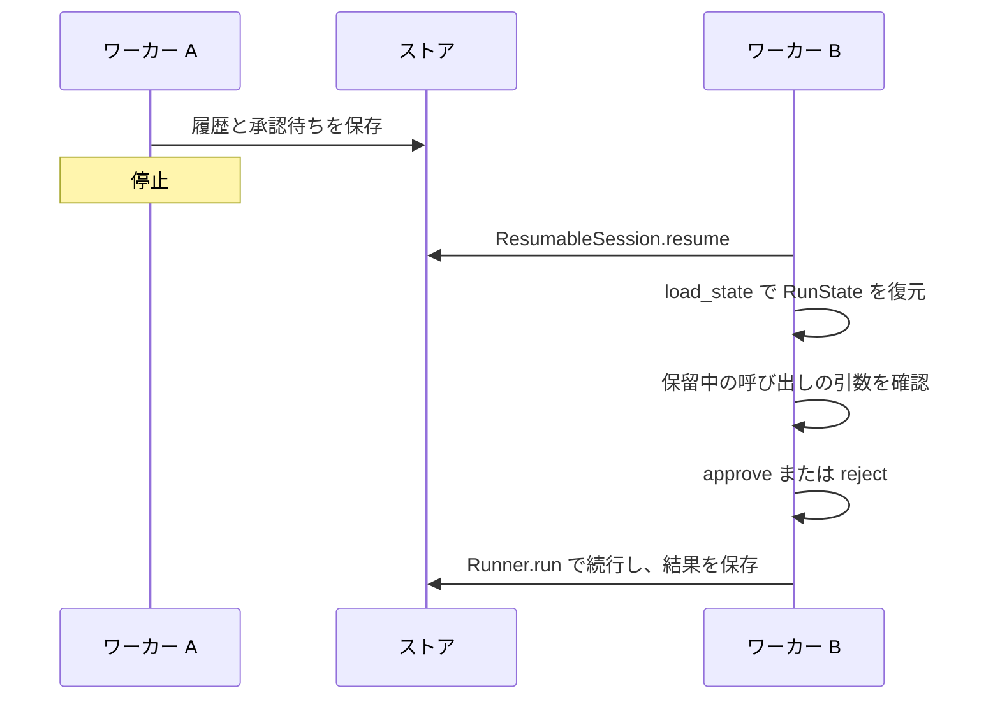

エージェントがツールを呼ぶ前に人間の承認を待つ構成では、待っている間にワーカーの Pod が入れ替わることがあります。承認が押されるのは数分後かもしれないし翌朝かもしれず、状態をプロセスの中にだけ持っていると、再起動で「何を承認しようとしていたのか」ごと消えます。

2026-11-23 に出た [Agents SDK v1.0.0-alpha.2](https://github.com/openai/openai-agents-python/releases/tag/v1.0.0-alpha.2) は、ここに手を入れています。リリースノートの最初の項目が「Resume conversations and pending approvals across workers with Responses or Codex」です。pre-release で、配布は GitHub のみです。

## 何が入ったか

中心は `ResumableSession` です。会話履歴と、承認待ちの状態（保留中のツール呼び出し）を、1 つのセッション ID の下にまとめて保存します。[セッションのドキュメント](https://github.com/openai/openai-agents-python/blob/v1.0.0-alpha.2/docs/sessions/index.md#use-your-own-storage-for-resumable-sessions)によると、保存先は Redis 用の `RedisSessionStore` が用意されているほか、自前のストアも書けます。

自前のストアに求められるのは async メソッド 2 つだけです。

- `load(session_id)`: 保存された文字列を返す。無ければ `None`
- `save(session_id, value, expected=...)`: `expected=None` なら「無いときだけ作成」、`expected=前の値` なら「今の値が前の値と完全に一致するときだけ置き換え」。成功したら `True`、条件が合わなければ `False`

1 セッション 1 レコードの compare-and-swap です。ドキュメントは、条件の確認と書き込みを同じ DB 操作で行うよう求めています。読んでから無条件に書く実装だと、2 つのワーカーが同じ承認に基づいて動きうるからです。公式の Codex 用サンプルは SQLite の `UPDATE ... WHERE id = ? AND value = ?` で実装していて、ストアのクラスは数十行に収まっています。

流れはこうです。

リリースノートによると、置き換え先のワーカーは `ResumableSession.resume(store, session_id)` でセッションを開き、`session.load_state(agent)` で `RunState` を得ます。保留中の呼び出しを `approve` か `reject` して、`Runner.run(agent, state, session=session, run_config=config)` で続けます。`config`（モデルプロバイダ、ツール宣言と認可ポリシー、フック、リダクタ）は保存されないので、置き換え側で作り直します。

確認の段は図に入れましたが、SDK が自動でやってくれるわけではありません。公式のサンプルは、復元した呼び出しのツール名と引数が想定したコマンドと一致するかを自分で調べてから承認しています。チェックポイントはアプリケーション内部の状態であり、クライアントから来た `RunState` ではない、という前提もサンプルに明記されています。

## 競合したとき、落ちたとき

書き込みは 1 セッションにつき 1 ワーカーだけです。違反すると `ResumableSessionError` が出て、`reason` で原因がわかります。

- `"conflict"`: 別のワーカーが先に書き換えた。セッションを読み直して、今の要求を確かめ直す
- `"active"`: 前のワーカーがまだ動いているかもしれない。動いているか確認し、止まっていたなら外部への影響を調べてから新しいセッションを始める

ドキュメントには、Pod が再起動しても続く長いジョブの例があります。ここでの前提は、実行そのものは SDK のワーカーの外にあるジョブサービスが持つことです。セッションには、ジョブを投入するツールが返した受領票（ジョブ ID）だけを保存します。ワーカーが投入の後、セッション保存の前に落ちると、再開時に `"active"` になりえます。このとき同じ仕事をもう一度投入せず、保存済みの ID でジョブを探せ、とドキュメントは書いています。

## Codex のネイティブ承認

Codex プロバイダ経由のコマンド承認とファイル編集承認も復元できますが、範囲は狭いです。リリースノートによると、対象は 1 つの保留中の `exec_command` または `apply_patch` を、1 つのローカル環境で扱う場合だけです。復元側は同じワークスペースのパス、同じ権限、必要なフックを用意する必要があり、対象ファイルは保存時点の状態と一致していなければなりません。必要なフックやツールが欠けると、承認は保留のままです。

落ちたコマンドを再起動することもできません。リリースノートは、ワーカーが失われたあとはチェックポイントとワークスペースを見て、途中まで進んだ編集などを整理してから再試行するよう書いています。alpha.1 の承認待ちのうち、モデル呼び出しが終わっていたものも復元できません。

## 上げる順番

状態の保存形式が新しくなりました。alpha.2 は alpha.1 のスキーマ 1.22 を読めますが、書くのは常に 1.24 で、alpha.1 はそれを読めません。リリースノートが「書き手より先に読み手をアップグレードせよ」としているのはそのためです。

## 私の見立て

承認待ちをプロセスの外に出す部品が SDK に入ったのは、自前でホストする側には助かると思います。ただ、保存されるのは履歴と保留中の呼び出しまでです。再開後に副作用がどこまで進んでいたかを確かめるコードは、自分で書くことになります。

私は alpha.2 を手元で動かしていません。ネイティブの Codex ランタイムを含む wheel と Codex のログインが要るためで、上の内容はリリースノート、ドキュメント、サンプルコードを読んだ範囲です。pre-release なので、API やスキーマはまた変わりうると思います。

## 出典

- [Agents SDK v1.0.0-alpha.2 リリースノート](https://github.com/openai/openai-agents-python/releases/tag/v1.0.0-alpha.2)
- [Sessions ドキュメント（v1.0.0-alpha.2）](https://github.com/openai/openai-agents-python/blob/v1.0.0-alpha.2/docs/sessions/index.md)
- [native_approval.py サンプル](https://github.com/openai/openai-agents-python/blob/v1.0.0-alpha.2/examples/codex/native_approval.py)
