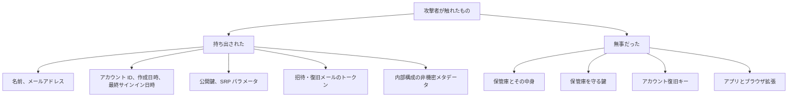

1Password が 11 月 25 日（現地）に、バックエンドシステムへの不正アクセスを[告知](https://x.com/1password/status/2125642686443258030)しました。詳細はリンク先の[ブログ](https://1password.com/blog/update-on-nov-2026-security-incident)にあります。先に結論を書くと、保管庫（vault）の中身は無事で、パスワードや Secret Key の変更は不要というのが 1Password の説明です。ただし一部の顧客のアカウント情報は持ち出されています。

## 何が起きたか

11 月 19 日に、従業員の会社用 GitHub アカウントを攻撃者が使っている兆候を見つけて調査を始めた、とブログにあります。攻撃者はそのアカウントでソースコードにアクセスし、バックエンドのサービスに悪意あるコードを push しました。そのコードが顧客の管理用データをダウンロードしました。非公開リポジトリのソースコードのコピーと、CI/CD システムへのアクセスも認めています。CI/CD にはインフラ用のシークレットが入っているため、漏れた可能性のある認証情報はすべてローテーションしたそうです。

## 盗まれたもの、無事だったもの

公開鍵は元々公開される前提のもの、SRP パラメータはそれだけではアカウントに入れないもの、と 1Password は説明しています。

気になるのはトークンです。1Password によると、トークン単体ではアカウントに入れず、SSO でのサインインか、登録メールに届く 6 桁のコードが追加で必要です。そのコードを 10 桁の英数字に延ばしたので、総当たりは現実的ではないとのことです。これは 1Password 自身の説明で、独立した検証はまだ出ていません。

## 通知が来ていなくても、対象外とは言えない

人数、攻撃者、データを抜かれた日時は公表されていません。ブログは「一部の顧客（a subset）」と書くだけです。自分のレコードが含まれているかを利用者が確かめる方法も、私が読んだ範囲では示されていません。

個別に通知したのは、招待や復旧の手続き中でトークンが有効な状態だった少数のユーザーです。名前やメールアドレスを抜かれた人はそれより広いはずで、[BleepingComputer](https://www.bleepingcomputer.com/news/security/1password-customer-data-stolen-after-employee-github-account-breach/) の「影響を受けたのは少数で、個別に通知した」という書き方だと、この区別が見えにくくなります。告知ポストの返信にも、メールが来ないのに SNS で知ったという不満が並んでいました。

## 取るべき対応

1Password の案内は「アカウントで更新が必要なものはない」で、勧めているのはフィッシングへの警戒です。名前とメールアドレスが分かれば、1Password 利用者宛ての偽メールが作りやすくなります。[9to5Mac](https://9to5mac.com/2026/11/25/1password-confirms-security-incident-heres-what-you-need-to-know) も、攻撃者が「情報を守るため」と装うメールを送る可能性を指摘しています。

- 自分で始めていない招待や復旧のメール、1Password を名乗る SMS や電話には反応しない
- メール内のリンクは開かず、アプリを開くか、アドレスを自分で入力してサインインする
- パスワード、Secret Key、確認コードは誰にも伝えない。1Password はパスワードや Secret Key を尋ねないと明言しています
- 怪しいものは support@1password.com に報告する

私の意見として、チームや企業のアカウントの管理者は、身に覚えのない保留中の招待がないかを見ておくといいと思います。トークンが効くのは招待や復旧の途中だからです。確認コードが届くメールボックスと、SSO の IdP の多要素認証も見ておく価値があります。パスワードの変更は 1Password が不要としているので、必須ではありません。

## GitHub アカウント 1 つから本番まで届いた点

私が引っかかったのは、入口が GitHub アカウント 1 つだったことです。乗っ取りからソース閲覧、CI/CD、本番への push まで進んでいます。手口（トークン窃取かパスワードか）や、push がどの経路でレビューを抜けたのかは公表されていません。対策として挙がっているのは GitHub・CI/CD・エンドポイントの統制強化と検知の追加までで、中身は書かれていません。

GitHub Actions で CI を回している私たちの立場なら、個人アカウントの権限だけで本番に届くコードを push できる経路がないか、CI/CD に置いたシークレットの範囲が広すぎないかを見直すきっかけになります。

保管庫については、鍵がユーザー側にしかないので、サーバーに入られても読めませんでした。この設計は 2015 年から[セキュリティ白書](https://agilebits.github.io/security-design/)として公開されています。続報があればブログを更新する、と書かれています。

## 出典

- [1Password on X（告知ポスト）](https://x.com/1password/status/2125642686443258030)
- [Update on a security incident involving 1Password's backend systems（1Password ブログ）](https://1password.com/blog/update-on-nov-2026-security-incident)
- [1Password customer data stolen after employee GitHub account breach（BleepingComputer）](https://www.bleepingcomputer.com/news/security/1password-customer-data-stolen-after-employee-github-account-breach/)
- [1Password confirms security incident, here's what you need to know（9to5Mac）](https://9to5mac.com/2026/11/25/1password-confirms-security-incident-heres-what-you-need-to-know)
- [Spot On Tech の解説記事](https://spotontech.com/blog/1password-breach-github-account-november-2026)
- [1Password Security Whitepaper](https://agilebits.github.io/security-design/)
