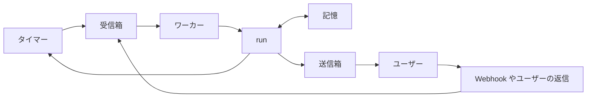

エージェントを cron で毎朝起動して、結果を Slack に流す。この形は手軽ですが、前回の run がまだ終わっていないうちに次が起動したらどうなるか、昨日送った内容を今日も送らないか、と考え始めると心もとなくなります。11 月 13 日に Anthropic が公開した [Building always-on agents](https://claude.com/resources/articles/building-always-on-agents) は、この周辺を 5 つの部品に分けて書いています。cron の構成に当てはめて読むと、何が足りないかがはっきりするので、その見比べを書きます。

## 5 つの部品

著者によると、常時稼働エージェントのループ自体は普通のエージェントと同じです。違いは周辺の仕組みで、ほとんどの時間は眠っていて、イベントが来たときだけ起きて 1 回の仕事（run）をし、結果を保存してまた眠ります。その周辺が次の 5 つです。

受信箱は、届いたイベントをいったん DB のテーブルに積んでおく場所です。ワーカーはそこから読んで run を起こします。記憶は run の間をつなぐファイル群で、run が読み書きします。送信箱は、結果をユーザーに届けるまでの待機場所です。権限は図の外にありますが、run が何をしてよいかを決めます。

## cron だけだと何が足りないか

cron が担当するのは、タイマーのうち「決まった時刻の繰り返し」だけです。残りを、記事の記述に沿って見ていきます。

**受信箱がない。** 記事は、イベント源がエージェントを直接呼ぶ作りに問題があると書いています。2 つのイベントが同時に来ると run が競合し、クラッシュするとイベントが消えるからです。対策は、受信箱ごとに動いてよいワーカーを 1 つだけにして、溜まったイベントをまとめて 1 回の run で処理することです。cron で時刻ごとに起動していると、前回の run が長引いても次が重なって始まります。

**タイマーが 1 種類しかない。** 記事はタイマーを、毎朝のニュースレターのような「スケジュール」と、エージェントが自分で決める「フォローアップ」（2 日後に返信を見に行く、など）に分けています。cron は前者だけです。後者は、人間が cron の表を書き換えない限り作れません。記事では、期限の来たタイマーを拾う scheduler が受信箱にイベントを書き、受信箱には「今すぐ処理できるもの」だけを置きます。

**何を覚えておくか。** 記事の経験則は、記憶には「もう一度調べられないこと」だけを入れる、です。入れるものは、ユーザーの指示、ユーザーについてのメモ、過去に送ったメッセージ、タスクの進捗の 4 種類です。毎日報告するエージェントでは「過去に送ったメッセージ」が特に効くと私は思います。これが無いと、似た内容が毎朝届きます。指示や送信済みの一覧は毎回読み込み、個別のノートや進捗は索引だけを読んで必要なときに開く、という分け方も紹介されています。

**権限。** run はユーザーの権限を持ったまま、人が見ていないところで動きます。記事は、認証情報をエージェントの環境の外のプロキシが付け足す形を勧めています。面白かったのは、Claude Code の hook で tool call を保留する仕組みを流用する話です。保留すると run はそこで終わり、セッションは呼び出しの途中で保存されます。ユーザーの承認は新しいイベントとして受信箱に戻り、新しい run がセッションを再開します。承認を待つあいだにプロセスが居座らないので、ワーカーは他のイベントを処理できます。

**送信箱。** たいていは「送る」ツールを直接呼ぶだけで足りて、正式な送信箱が要るのは、送る間隔を調整したいときや、送信失敗から回復したいときだと書かれています。送る量については、最初は静かに始めて、徐々にユーザーの注意を得ていくのがよいとされ、調整には eval を作ることが勧められています。

## まず確かめること

5 つの部品の表に今のエージェントを当てはめるなら、私は次の 2 点から見ます。

- 同じエージェントが二重に走っても壊れないか。受信箱にあたるものが無いなら、壊れないとは言えません。
- 前回何を報告したかを、エージェントが読める場所に持っているか。

## 出典

- [Building always-on agents（Claude、2026-11-13）](https://claude.com/resources/articles/building-always-on-agents)
