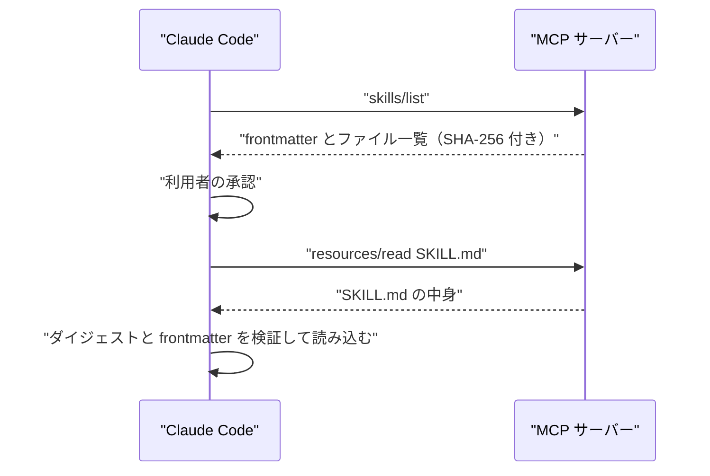

MCP サーバーを作っていると、ツールの description がどんどん長くなっていきませんか。「A を呼ぶ前に必ず B で確認する」「この 3 つはこの順で使う」といった手順を、ほかに置き場所がないので description に詰めることになります。Claude Code 2.1.332 で入った MCP スキル対応は、その置き場所をサーバー自身に作る機能です。[リリースノート](https://github.com/anthropics/claude-code/releases/tag/v2.1.332)には、サーバーのスキルが `/` メニューに `server:skill` の形で出る（beta）とあります。

## 仕組み

土台は MCP の拡張仕様（`io.modelcontextprotocol/skills`）です。[仕様のページ](https://modelcontextprotocol.io/extensions/skills/overview)によると、スキルの実体は普通の SKILL.md で、サーバーが `skills/list` で一覧を返します。各スキルには frontmatter と、全ファイルの URI・SHA-256・サイズが付きます。ファイル本体は既存の `resources/read` で取るので、新しく決められたのは一覧と検証の部分だけです。

[発表記事](https://claude.com/resources/articles/skills-over-mcp-tasks-and-more)は、スキルは必要になるまで読み込まれず、サーバーの更新と一緒に更新されると説明しています。利用者が別にインストールするものはありません。

## 承認がダイジェストに紐づく

読んでいて一番よく考えてあると思ったのはここです。仕様では、利用者の承認はファイルの URI とダイジェストの組全体に紐づき、ファイルが一つでも変わる・増える・減ると失効して、再承認が必要になります。サーバー側が承認済みのスキルの中身を黙って差し替えることはできません。

そのぶん、サーバーを更新してスキルが変わるたびに承認が挟まるはずです。Claude Code の画面でそれがどう見えるかは、手元が 2.1.332 より前なので試していません。

仕様にはほかに、次の取り決めがあります。

- 同名のスキルが別のサーバーから来ても、黙って置き換えない。同一性はサーバーと URI の組で決まる
- スキルの中身は信頼できない入力として扱い、コード実行や `allowed-tools` の付与にはスキルごとの明示的な承認が要る
- 一つのスキルは 512 ファイル・16 MiB まで（サーバー側の SHOULD）

## 置き場所の使い分け

特定サーバーのツールにしか意味を持たない手順は、サーバー側に置くのがよいと私は考えています。ツールの正しい使い方を知っているのはサーバーの作者だからです。一方、レビューの観点や社内の書式のように利用者や組織ごとに違う判断基準は、サーバーの作者には分かりません。こちらはこれまで通り自分のスキルに置きます。

Go で MCP サーバーを書いているなら、冒頭の長い description が最初の切り出し候補です。description は常にコンテキストに載りますが、スキルは必要なときだけ読まれます。

同じ日の発表では、Tasks（長い処理をサーバー側で走らせ、結果を後で受け取る）と Elicitation（削除や課金の前にサーバーが利用者へ確認を取る）も正式提供になっています。スキルとは別の機能なので、ここでは触れません。

## 出典

- [MCP servers can now ship skills, run tasks, and more with Claude](https://claude.com/resources/articles/skills-over-mcp-tasks-and-more)（Claude、2026-11-24）
- [Claude Code v2.1.332 リリースノート](https://github.com/anthropics/claude-code/releases/tag/v2.1.332)
- [Skills（MCP 拡張仕様）](https://modelcontextprotocol.io/extensions/skills/overview)
- [ext-skills の仕様本文](https://github.com/modelcontextprotocol/ext-skills/blob/main/specification/beta/skills.mdx)
