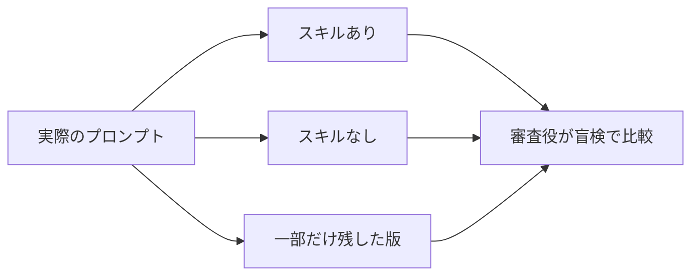

SKILL.md を書いて使っていると、そのスキルが本当に効いているのか、モデルが素のままでもできることを書いているだけではないのか、が気になってきます。Uber Engineering が 11 月に出した「[How Uber Evals 1 Million Agent Skill Invocations a Month](https://x.com/ubereng/status/2125008806249930999)」は、まさにそこを測る話でした。社内のスキルが 1 年で 5,000 本を超え、1 か月に 100 万回以上呼ばれている会社が、効果とコストをどう確かめているかが書かれています。配布の仕組みや社内ツールの話も多いのですが、ここでは評価とコストの部分に絞ります。

## スキルあり・なしで比べる

著者らは、実際に使われたプロンプトを「スキルあり」と「スキルなし」で 1 回ずつ再生し、どちらの答えが良いかを、どちらがどちらか知らない審査役に選ばせています。スキルの一部だけを残した版や、文言を削った版でも同じことをします。理由は「モデルが良くなると、言葉が多いほど性能が下がることがある」からだそうです。

ウェアハウスにクエリを投げるスキルでは、スキルなしのセッションはツール呼び出しが 13% 多く、ツールエラーが 6 倍、所要時間が 31% 長く、スキルありの答えが 87% の比較で勝ちました。全体では、多くの場合スキルがあるほうが成功率が高く、コストも低かったとのことです。大きく効いたのは、社内ドキュメントへのアクセスやクエリ実行のように、エージェントが自力では見つけにくいものを渡すスキルでした。

私は、モデルが自力でできることを書いただけのスキルは、削っても差が出ないはずだと思います。過去のプロンプトを数本流して比べるだけでも、残すか削るかの判断材料になります。

## 評価セットの中身

1 つのスキルの評価セットに入れるプロンプトの目安は、次の割合です。

- 約 5%: 入力と期待する出力が固定の golden case（ツールはモック）
- 約 80%: 実際のプロンプトを、軌跡で採点するもの
- 約 15%: 作者が自分で判定するもの

軌跡（trajectory）は、最終的な答えではなく、エージェントがどう動いたかを採点する方法です。期待したツールを使ったか、テーブルを引いたか、ドキュメントを読んだか、失敗したときにスキルに書いた復旧手順を確認したか、を見ます。答えは毎回揺れるので、動き方のほうを見るわけです。

著者らは、合格率が 70〜90% の評価のほうが 100% より役に立つことがある、とも書いています。100% だと、答えの意味のある違いを拾えていない評価かもしれない、という理屈です。経験則として書かれていて、データは載っていません。

評価はまっさらなリモート環境でも走らせています。特定のファイルパスやキャッシュ済みの文書、OS 側のツールに頼っているスキルが、そこで多数見つかったそうです。

スキルの書き方については、過去の問題や論文、プロンプトガイドから作った linter の項目が 3 つ紹介されています。

- 手順に番号があり、各手順の目的が 1 つで、少なくとも軽く検証できる
- 各手順が具体的なコマンドを示し、次に進む前に結果を確認する
- 失敗と対処の表（エラー復旧の節）がある。「もう一度試す」は対処に数えない

## コストは呼び出しの前後の差で測る

エージェントはセッションの累計コストを持っていて、テレメトリが定期的に報告します。スキルを呼ぶ直前の累計と直後の累計を引くと、その呼び出しのコストになります。スキルを読むコストだけでなく、続くターンやその間のほかのツール呼び出しも入る数字で、スキルを変更する前後の比較に使うものだと断られています。

下げ方は 4 つ挙がっています。

- 毎回同じ手順はスクリプトにします。MCP を普通に入れると、100 個を超えるツールの定義だけで 5 万〜7 万トークンになります。そこで Uber は、社内の中継サーバー（ゲートウェイ）にスクリプトからツールを呼ばせ、結果の必要な部分だけ読む形にしました。[Cloudflare の Code Mode](https://blog.cloudflare.com/code-mode/) に着想を得たそうです
- スキルをサブエージェントに任せ、安いモデルで動かします。大きな結果はサブエージェントの中に留めて要約だけ返し、トレーシングのスキルで 1 回あたり 46% 減りました。デプロイのスキルは最初の 1 週間は下がらず、変更ごとに測っているそうです
- 毎回必要で小さい結果は、スキルの読み込み時にスクリプトを実行してプロンプトに入れます。検索スキルは 4 ターンが 3 ターンになり、平均コストが 32% 減りました
- ポーリングはメインのセッションから外します。支出の多い上位 20 セッションでは、通知のターンが約 3 分の 1 を占めていました

## エージェント自身にバグ報告させる

常時有効にしたスキル（log-papercut）で、エージェントが詰まったときや、ツールの挙動がおかしいときに、試したこと・期待・結果・直し方を報告させています。報告はスキル別にダッシュボードへ集まり、3 か月で数千件、そのうち数百件が修正済みだそうです。

例を 2 つ挙げます。PR スキルがコミットメッセージを共有の一時ファイルに書いていたため、並行する 2 セッションが互いの PR を書き換えました。別の設定取得スキルは、キーがないときにエラーを返さず、別のプロパティの値を返しました。どちらも、実際にエージェントが動いて初めて表に出た不具合です。

著者は、報告を促すことで、エージェントが「環境が壊れていることもある」と知り、その場のセッションにも効くと書いています。

## 自分のスキルで試すなら

1. 重要なスキルを 1 本選び、過去に投げたプロンプトをスキルありとなしで流して比べる
2. 失敗と対処の表がなければ、実際に詰まった事例から足す
3. 毎回同じ手順や、大きな出力を返す手順は、スクリプトに寄せられないか考える

ここまでの数字はすべて Uber 自身の報告で、評価基盤（Skill Workshop）のコードは公開されていません。

## 出典

- [How Uber Evals 1 Million Agent Skill Invocations a Month（Uber Engineering, X）](https://x.com/ubereng/status/2125008806249930999)
- [Agent Skills specification](https://agentskills.io/)
- [Cloudflare Code Mode](https://blog.cloudflare.com/code-mode/)
