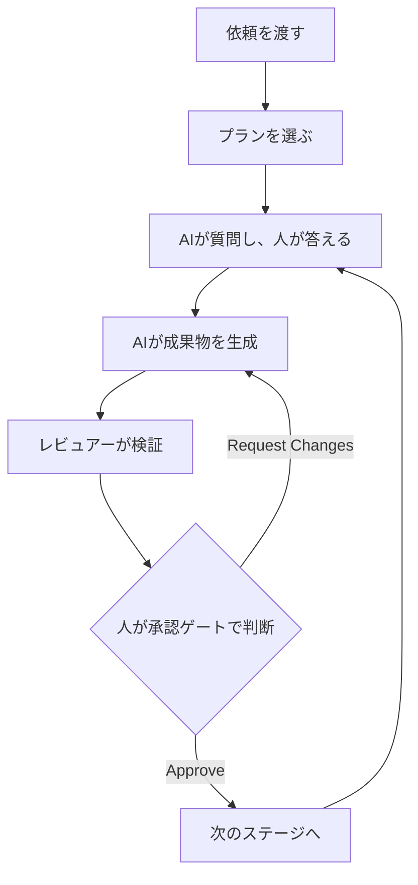

Codex CLI や Claude Code に「この機能を追加して」と頼むと、うまくいくときは速いのですが、途中で何を決めたのか、誰が承認したのかは、チャットのログを遡らないとわかりません。AWS Labs の [aidlc-workflows](https://github.com/awslabs/aidlc-workflows) は、その部分を仕組みにしたものです。進行と記録はコード製のエンジンが持ち、質問・生成・レビューは AI が行い、承認だけを人間が行います。確認日（2026-11-27）時点の最新安定版は [v2.11.5](https://github.com/awslabs/aidlc-workflows/releases/tag/v2.11.5) です。

既存の Go バックエンドに日次集計機能を足す場面を例に、何が起きるのかと、自分のチームで試す価値があるのかを書きます。私の結論は、小さな変更を 1 件だけ試すなら手間は小さく、設計レビュー済みのチームが要件整理から使うと文書が重なりやすい、です。効果を示す数字は公式資料に見つかりませんでした。

実機で確かめたのは、Linux x64 でのインストール、`aidlc config --harness codex`、`aidlc doctor` までです。Codex CLI とモデルを使った実際のワークフローは動かしていないので、日次集計の流れは公式の説明を当てはめた私の想定です。公式サイトは main の内容で、v2.11.5 のタグ専用のものは見つけられませんでした（リリース後に main は 24 コミット進んでいます）。

## AI-DLC と aidlc-workflows

AI-DLC は、AWS が [DevOps ブログ](https://aws.amazon.com/blogs/devops/ai-driven-development-life-cycle/)で提唱した開発方法論です。AI が計画を作って質問し、人間が検証してから実装する、というサイクルを全工程で回します。aidlc-workflows はそれをコーディングエージェント上で動かす実装で、[README](https://github.com/awslabs/aidlc-workflows) によると Claude Code、Codex CLI、Kiro、Cursor、opencode、GitHub Copilot に対応しています。

v1 と v2 の違いは、[AWS Builder Center の解説](https://builder.aws.com/content/3HQgsojfwGT7m4UTYZHV2jMPcDU/ai-dlc-workflow-v1v2)が詳しいです。筆者によると、v1 はルールファイルをコピーする方式で、「次に何をするか」の判断も状態ファイルの読み書きも LLM が担い、検証は全サイクルで人間が行っていました。v2 は担い手を分けています。

| 担い手 | 受け持つこと |
|---|---|
| エンジン（TypeScript 製の CLI） | 次のステージの決定、状態の更新、監査ログの記録 |
| AI（14 のエージェント） | 質問、成果物の生成、別エージェントによるレビュー |
| 人間 | 承認ゲートでの判断、設計上の決定 |

同じ記事は監査イベントを「74 種類・19 カテゴリ」と書いていますが、2.11.5 の[公式ガイド](https://awslabs.github.io/aidlc-workflows/guide/10-state-and-audit)は 134 種類・27 カテゴリです。記事は少し古い版を元にしているようなので、数字は公式ガイドを見てください。

## 依頼から再開までの流れ

[Your First Workflow](https://awslabs.github.io/aidlc-workflows/guide/02-your-first-workflow) と [Session Management](https://awslabs.github.io/aidlc-workflows/guide/11-session-management/) をつなぐと、次の流れです。



依頼は Codex CLI では `$aidlc ...`、それ以外では `/aidlc ...` で渡します。エンジンが既製のプラン（11 種類。`feature`、`bugfix`、`express` など）を提案し、ステージ数と承認ゲートの数も示すので、始める前に手間の見当がつきます。

ステージごとに、AI が質問を 1 つのファイルに書き出します。答え方は、チャットで 1 問ずつ、ファイルを直接編集、自由に話す、の 3 つから選べます。成果物ができると別のレビュアーエージェントが検査し、承認ゲートには指摘の一覧（R-01、R-02 など。重大度付き）と Approve / Request Changes が出ます。Request Changes なら AI が直してゲートが開き直します。

中断は、承認と同時に「今日はここまで」と伝えるか `/aidlc park` です。再開は新しいチャットで引数なしの `/aidlc`（または `--resume`）で、状態はディスクにあるので続きから始まります。失われるのは、ファイルに書かれていない会話の内容だけです。

### 何が残るか

状態は `aidlc-state.md` に、履歴は `audit/` 配下の Markdown に残り、どちらも Git にコミットする前提です。`aidlc-state.md` は上書きされる現在地で、選んだステージ、各ステージの進み具合（`[?]` が承認待ち、`[x]` が完了など）、再開地点が入ります。監査ログは追記専用で、ステージの開始と完了、質問への回答（`Person Reply`）、承認と差し戻し、承認した人の `git config user.name` などが 1 イベントずつ並びます。

あとから、次のことを確かめられます。

- どの質問に誰がどう答えたか（`aidlc engine log answers --stage`）
- ゲートでどの指摘をリスクとして受け入れたか。Approve は開いている指摘をすべてリスクとして受け入れる操作で、一覧は質問の直前に出ます
- 承認の時刻と順序（`aidlc engine audit history`）

成果物の変更として記録されるのは、エージェントがファイルツールで書いたものだけで、シェルで書いたものは記録されません。Codex の[公式ガイド](https://awslabs.github.io/aidlc-workflows/guide/harnesses/codex-cli/)は、ヘッドレスの `codex exec` では記録が薄くなるので、対話型の TUI のほうが記録の精度が高いと書いています。

## 日次集計の追加では、誰が何を決めるか

既存の Go 製バックエンドに、日次の集計バッチを足すとします。以下の質問や成果物は、公式のステージ構成を当てはめた想定です。

既存コードがあるので、Reverse Engineering というステージが走り、開発エージェントがコードを走査して知識文書を 9 つ書きます。プランは、本番向けの機能なら `feature`（開始後 30 ステージ）か V1 に近い `classic`（15 ステージ）、小さければ `express`（7 ステージ）に追加ステージを足す形です。

| 項目 | 決める人 | 確かめる手段 |
|---|---|---|
| 締め時刻とタイムゾーン | 人間（業務判断） | 承認ゲートで仕様を読む |
| 締め後に届いたデータを前日と当日のどちらに入れるか | 人間（業務判断） | 同上。期待値をテストに反映する |
| 再実行時に上書きか追記か | 人間（設計判断） | 同じ入力で 2 回流して結果が同じかを見るテスト |
| 集計の数値 | 機械 | ゴールデンファイルや手計算との突き合わせ |
| 依存方向の維持 | 機械 | 既存の静的解析（`go vet`、リンター） |
| 既存 API の非破壊 | 機械 | 既存のテスト（`go test ./...`） |

設計書に答えがある質問は、最初の 1 つの質問にまとめて確認され、書いていないことや文書同士の食い違いだけが改めて聞かれます（[Knowledge](https://awslabs.github.io/aidlc-workflows/guide/08-knowledge/)）。Construction では実装計画（`code-generation-plan.md`）が承認の対象になり、そのとき各ユニットの完了確認に使うコマンドをエンジンが提案して人間が承認します。公式の例は `bun test` や `make check` です。Go なら CI と同じ `make test` か `go test ./...` を承認するのがよいと思います。AI-DLC と CI で別のテストを走らせると、どちらを信じるのかが曖昧になるからです。

変更の種類による違いは、次のとおりです。効果の欄は、公式の説明から私が読み取った見込みです。

| | 新規開発 | 既存機能への追加 | 小さなバグ修正 |
|---|---|---|---|
| 向くプラン | `mvp` / `feature` | `classic` / `feature`、小さければ `express` | `bugfix`（6 ステージ） |
| 得られやすい効果 | 要件から設計、コードまでのつながりが残る | 既存コードの理解と決定の履歴が残る | 回帰テストと承認の記録が残る |
| 手間 | 質問と承認が多い | 既存コードの走査が加わる | 少ない |

## 動作環境と試し方

[Install and Lifecycle](https://awslabs.github.io/aidlc-workflows/guide/18-install-and-lifecycle/)、[Getting Started](https://awslabs.github.io/aidlc-workflows/guide/01-getting-started/)、[Codex CLI ガイド](https://awslabs.github.io/aidlc-workflows/guide/harnesses/codex-cli/)から整理すると、次のとおりです。

| 項目 | 要件 |
|---|---|
| OS | macOS（x64、arm64）、Linux（x64、arm64）、Windows x64、WSL |
| AI-DLC 本体 | ネイティブインストーラー。Bun と Node.js は不要。ユーザー単位で、root では拒否される |
| Codex CLI | 0.145.0 以上。対象プロジェクトが Git リポジトリであること（hooks が Git リポジトリ内でしか見つからないため） |
| Claude Code | 最小バージョンの記載は見つからなかった。Git は必須でない |
| モデル | ハーネスが選んだものをそのまま使う。Bedrock は明示的に選んだときだけ |

費用は、AI-DLC 本体が [MIT-0](https://github.com/awslabs/aidlc-workflows/blob/v2.11.5/LICENSE) で無料で、モデルの利用料は使っているハーネスの契約に乗ります。Codex CLI は認証情報とモデルを `~/.codex/config.toml` から引き継ぐので、すでに Codex を使えていれば AWS アカウントは要らないはずです。ChatGPT ログインで使えるかを明記した記述は見つからず、私も確認していません。公式は、1 つのワークフローが多数のターンを使うので、推論の強さを高くすると遅く高くなると書いています。

### macOS と Codex CLI での手順

以下は公式の手順です。実機で確かめたのは Linux x64 で、macOS では試していません。

```sh
curl -fsSL https://github.com/awslabs/aidlc-workflows/releases/download/v2.11.5/install.sh | sh -s -- --version 2.11.5
```

```sh
cd your-go-backend
aidlc config --harness codex
aidlc doctor
```

`aidlc version` は `aidlc 2.11.5 (runtime 2.11.5)` と出ました。Codex が入っていない環境で `aidlc doctor` を実行すると `0 problems, 5 warnings` で、Codex がないこと、フックがまだ動いていないこと、設定が Git に未コミットであることなどが警告に出ました。そのあとは次の手順です。

1. `codex` を起動し、フックの確認で「Trust all and continue」を選ぶ。Codex は信頼していないフックを実行しない
2. `$aidlc --doctor` で確認する
3. `$aidlc 既存の Go バックエンドに日次集計機能を追加する` のように依頼する
4. プランを選び、質問の答え方を選び、最初の承認ゲートで Approve か Request Changes を選ぶ

最初のゲートの画面は、公式が Claude Code の例（在庫管理 API）で示しています。Claude Code では、設定が `aidlc config --harness claude`、置かれるのが `.claude/`、`.mcp.json`、`aidlc.settings.json`、`aidlc/`、呼び出しが `/aidlc` になります。`.claude/settings.json` が 45 件のツール許可を事前承認していて、初回起動時に Claude Code がそれを一覧で見せます。

### 既存の AGENTS.md と .codex/ への影響

空の Git リポジトリに `AGENTS.md`（2 行）と `.codex/config.toml`（`model = "gpt-5"` の 1 行）を置いて設定したところ、既存の 2 行と `model` はそのまま残り、`AGENTS.md` の末尾に `<!-- BEGIN AI-DLC:agents -->` から `<!-- END AI-DLC:agents -->` までのブロックが足されました。ほかに 454 ファイルが増え、`.gitignore` と `.codex/rules/default.rules` も作られました。

気をつけるのは 2 点です。`.codex/config.toml` に足される設定に `network_access = true`（サンドボックス内でネットワークを許可）があり、そのプロジェクトでの Codex の作業全体に効きます。公式は false に直せて、更新後も値が保たれると書いています。また、`.codex/hooks.json` と `.codex/rules/default.rules` は AI-DLC のものとして扱われ、自前のものがあると設定が衝突で止まると公式にあります。この場合は試していません。

## 既存の設計・レビュー工程に組み込む

ユースケース記述、ロバストネス分析、設計レビューを済ませ、実装は DDD やクリーンアーキテクチャで書くチームを想定します。案 A は既存の設計書を入力に実装と検証から、案 B は要件整理から使う方法です。

案 A には、専用の設定が見つかりませんでした。使える部品は、依頼文で文書を指定する、`knowledge onboard` で取り込む、`--stage code-generation` で飛ぶ、`--skip` / `--add` で絞る、の 4 つです。`onboard` は文書を AI-DLC の `knowledge/documents/` にコピーし、以後はそのコピーを読むので、設計書を直したら取り込み直す二重管理になります。ステージを飛ぶと、あとのステージが飛ばした文書を期待することがあると [Session Management](https://awslabs.github.io/aidlc-workflows/guide/11-session-management/) にあり、設計書だけで Code Generation が十分に動くかは確かめていません。人間が読むのは、実装計画、差分、テスト結果です。DDD の層の切り方や依存方向のような決まりは、`aidlc/spaces/default/knowledge/aidlc-shared/` か規則ファイル（`team.md`、`project.md`）に書くのが公式の想定です。

案 B はプランをそのまま使うので設定は要りませんが、要件やドメイン設計の文書が `aidlc/` 配下に生成され、既存のユースケース記述と重なります。ロバストネス分析に 1 対 1 で当たるステージは、公式資料から読み取れませんでした。人間が読むものは、各ステージの文書と実装計画、差分、テスト結果に増え、ゲートも既存の設計レビューと重複しがちです。

確認の分担は、こう整理できます。AI レビュアーは文書の抜けや矛盾、上流の要件との対応を見られますが、締め時刻が業務として正しいかは判断できません。承認ゲートは意図に合っているかを判断する場で、実装が動くかは読むだけでは確かめきれません。振る舞いと規約違反は、既存 CI のテストと静的解析が確かめます。AI-DLC にもリンターと型チェックのセンサーが付属していますが、Go でどこまで効くかは確かめていないので、CI の `go vet` やリンターは残すのが安全です。

レビューが減りそうなのは、同じ指摘を毎回繰り返している場面です。AI-DLC は人間の修正を規則として保存する学習の仕組みを持ち、ステージの終わりに「Keep that for next time?」と聞きます（`classic`、`bugfix`、`express` では切られている種類があります）。Builder Center の記事はこれを「使うほど人間の負荷が下がる」と説明していますが、数字は出していません。保存した規則が後続の作業で実際に読み込まれて初めて効きます。

増えるのは、承認待ちと読む文書です。`feature` は承認ゲートが 30 あり、設定だけで数百ファイルが増え、監査ログも作業のたびに増えます。Approve は開いている指摘をリスクとして受け入れる操作なので、急いで押すと、指摘が残ったことにあとで気づくことになります。

## 小さな変更 1 件で試す

範囲は、既存の Go リポジトリの小さな変更 1 件です。日次集計に集計軸を 1 つ足す、既知の集計バグを 1 件直す、といった規模を考えています。

- プランは、機能追加なら `express` に Functional Design を足し（`/aidlc express --add functional-design <変更内容>`）、バグなら `bugfix` にします。公式も、小さな変更では `feature` ではなくこの形を勧めています
- 設定のコミットは、機能の変更とは別の PR にします。数百ファイルが変更本体の差分に混ざらないようにするためです
- 完了確認のコマンドは CI と同じものを承認します
- 比較の基準は、同じ規模の変更を普段のやり方でやったときの記録です

| 指標 | 測り方 |
|---|---|
| 人間のレビュー時間 | PR を読んだ時間と承認ゲートに答えた時間を別々に記録する |
| 承認待ち時間 | 監査ログで、ゲートが開いた時刻から承認までの差（`aidlc engine audit history --stage`） |
| 手戻りの件数 | Request Changes の回数と PR の差し戻しの回数 |

1 件だけでは偶然の差と見分けられません。この試行で見るのは、時間がどのゲートで使われたかだと思います。

## まとめ

aidlc-workflows の v2 は、進行と記録をエンジンに、生成と検証を AI に、判断を人間に割り当てます。中断しても状態がディスクに残って再開できること、承認が記録に残ることは、公式資料から確かです。レビュー工数の削減や品質向上の実測は見つかりませんでした。

設計レビュー済みのチームでは、案 A に専用の設定がなく、案 B は文書が重なります。まず小さな変更 1 件で、ゲートの数と時間を測りながら試すのがよいと思います。

## 出典

- [awslabs/aidlc-workflows（README）](https://github.com/awslabs/aidlc-workflows)
- [リリース v2.11.5](https://github.com/awslabs/aidlc-workflows/releases/tag/v2.11.5)
- [LICENSE（v2.11.5、MIT No Attribution）](https://github.com/awslabs/aidlc-workflows/blob/v2.11.5/LICENSE)
- [AI-DLC Workflows ドキュメントのトップ](https://awslabs.github.io/aidlc-workflows/)
- [Getting Started](https://awslabs.github.io/aidlc-workflows/guide/01-getting-started/)
- [Your First Workflow](https://awslabs.github.io/aidlc-workflows/guide/02-your-first-workflow)
- [Workflow Profiles](https://awslabs.github.io/aidlc-workflows/guide/workflow-profiles/)
- [Scopes, Depth, and Test Strategy](https://awslabs.github.io/aidlc-workflows/guide/05-scopes-and-depth/)
- [Knowledge](https://awslabs.github.io/aidlc-workflows/guide/08-knowledge/)
- [State Tracking and Audit Trail](https://awslabs.github.io/aidlc-workflows/guide/10-state-and-audit)
- [Session Management](https://awslabs.github.io/aidlc-workflows/guide/11-session-management/)
- [Install and Lifecycle](https://awslabs.github.io/aidlc-workflows/guide/18-install-and-lifecycle/)
- [AI-DLC on Codex CLI](https://awslabs.github.io/aidlc-workflows/guide/harnesses/codex-cli/)
- [AI-Driven Development Life Cycle（AWS DevOps ブログ）](https://aws.amazon.com/blogs/devops/ai-driven-development-life-cycle/)
- [AI-DLC Workflow V1からV2へ（AWS Builder Center）](https://builder.aws.com/content/3HQgsojfwGT7m4UTYZHV2jMPcDU/ai-dlc-workflow-v1v2)
