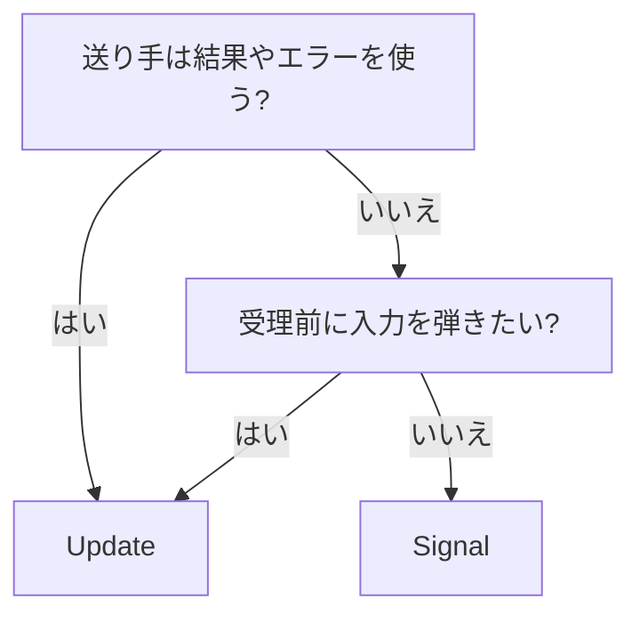

承認ボタンやキャンセル操作のように、HTTP API から動いている Workflow に何かを送る場面で、Signal と Update のどちらを使うか迷うことがあると思います。公式ドキュメントと Temporal 社のブログを読み直したので、使い分けと、Go で Update を使うときに引っかかりそうな点を書きます。

## Signal と Update で変わること

[Go SDK のドキュメント](https://docs.temporal.io/develop/go/message-passing)によると、`SignalWorkflow` は Server が受け付けた時点で返ります。Workflow に届いたかも、処理が終わったかも待ちません。Update は Worker が受理するまで呼び出し側が待ち、`WaitForStage` に `Completed` を指定すれば、処理の結果かエラーまで受け取れます。

Update が出る前は、Signal を送って Query でポーリングするのが定番でした。Temporal 社の [Update GA のブログ](https://temporal.io/blog/announcing-a-new-operation-workflow-update)は、Signal 単体のほうが Update よりレイテンシが低いと書いています。そのうえで、結果を受け取りたいときは Signal + Query ポーリングより Update のほうが速いと、計測のグラフを添えて述べています。グラフの数値は画像で、私は読めていません。

選ぶ順序を図にすると次のとおりです。



[概要ページの比較表](https://docs.temporal.io/encyclopedia/application-message-passing)も、結果や例外が欲しい、受理前に検証したい、という点を Update 側の条件に挙げています。Validator で弾いた Update は履歴に残りません。通れば `WorkflowExecutionUpdateAccepted` が履歴に入ります。

## Update が使えても Signal のままにする場面

次の 2 つは、Signal を選ぶ理由になると私は思います。

1 つ目は、Worker が止まっていても受け付けたい場合です。Update は Worker がいないと、コンテキストが切れるまで SDK がリトライし続けます（[Go SDK のトラブルシュート節](https://docs.temporal.io/develop/go/message-passing)）。デプロイ中に Webhook を取りこぼしたくないような入口なら、Signal のほうが安全です。

2 つ目は、件数が多い入口です。[Temporal Cloud の上限ページ](https://docs.temporal.io/evaluate/cloud/limits)では、1 つの Workflow Execution あたり、Update は同時処理中が 10 件、履歴に残る合計が 2000 件です。Signal は合計 10,000 件までで、同じページに、継続的に送るなら 1 秒あたり 5 件以下が目安とあります。Update のほうが上限がかなり低いので、イベントの流入口には向きません。これは Cloud の数字で、自前でサーバーを運用する場合の既定値は読んでいません。

## Go で Update を書くときに引っかかるところ

Update ハンドラはメインの関数と並行に動きます。Activity を呼ぶハンドラが 2 つ同時に走ると、片方が書き込んだ途中の値をもう片方が上書きする、という例がドキュメントに載っています。`workflow.NewMutex` でロックするのが公式の対処です。Signal をチャネルで 1 件ずつ受ける書き方なら起きにくい問題なので、ハンドラ形式を選ぶとこの面倒を自分で引き受けることになります。

終了のときも注意が要ります。メインの関数が先に return するか Continue-As-New すると、実行中の Update は「workflow execution already completed」で失敗します。return の前に `AllHandlersFinished` を待ってください。Update ハンドラの中から Continue-As-New はできません。Signal のチャネルも、終了前に `ReceiveAsync` で空にしないと残りが失われます。

```go
if err := workflow.Await(ctx, func() bool {
	return workflow.AllHandlersFinished(ctx)
}); err != nil {
	return err
}
```

クライアント側は、`context.WithTimeout` を必ず付けます。長く掛かる処理なら `WaitForStage` を `Accepted` にして handle を受け取り、あとで `Get` する形にすると、HTTP リクエストを開いたままにせずに済みます。

ハンドラのバグで Workflow Task が失敗し続けた場合は、受理前なら `FAILED_PRECONDITION` が返ります。受理後の Update は永続化されているので、修正をデプロイしたあとに handle から結果を取れる、とドキュメントにあります。

Update-with-Start は、Workflow がなければ起動してそのまま Update する API です。`WorkflowIDConflictPolicy` が必須で、ドキュメントは `UseExisting` と冪等なハンドラの組み合わせを勧めています。クライアントが再実行しても二重に効かないようにするためです。

## サンプル

承認を Update で受ける最小の形を、ドキュメントのサンプルから縮めて書きました。コンパイルして確かめてはいません。

```go
func ApprovalWorkflow(ctx workflow.Context) (string, error) {
	var approver string
	approved := false

	err := workflow.SetUpdateHandlerWithOptions(ctx, "approve",
		func(ctx workflow.Context, name string) (string, error) {
			approver, approved = name, true
			return "approved by " + name, nil
		},
		workflow.UpdateHandlerOptions{
			Validator: func(ctx workflow.Context, name string) error {
				if name == "" {
					return fmt.Errorf("approver name is required")
				}
				return nil
			},
		})
	if err != nil {
		return "", err
	}

	if err := workflow.Await(ctx, func() bool { return approved }); err != nil {
		return "", err
	}
	if err := workflow.Await(ctx, func() bool {
		return workflow.AllHandlersFinished(ctx)
	}); err != nil {
		return "", err
	}
	return approver, nil
}
```

HTTP ハンドラ側は `UpdateWorkflow` に `WorkflowUpdateStageCompleted` とタイムアウト付きのコンテキストを渡し、Validator のエラーは 4xx、タイムアウトは 5xx に対応させるのが自然だと思います。

## 出典

- [Workflow message passing - Go SDK](https://docs.temporal.io/develop/go/message-passing)
- [Temporal Workflow message passing - Signals, Queries, & Updates](https://docs.temporal.io/encyclopedia/application-message-passing)
- [Announcing a new operation: Workflow Update](https://temporal.io/blog/announcing-a-new-operation-workflow-update)
- [Safe and scalable signal handling in Temporal Workflows](https://temporal.io/blog/robust-message-handlers)
- [System limits（Temporal Cloud）](https://docs.temporal.io/evaluate/cloud/limits)
